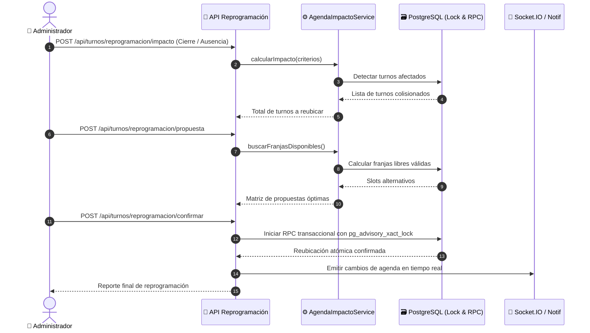
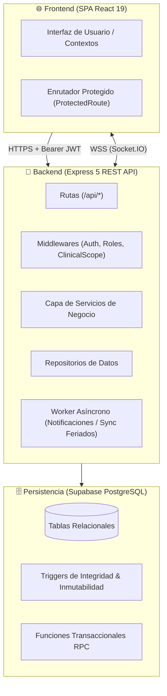

<a id="inicio"></a>

<div align="center">

# 🩺 CORA · SAPS Turno

### Plataforma de Gestión Integral de Turnos, Atención Primaria e Historia Clínica Electrónica

**Salas de Atención Primaria de la Salud (SAPS) · Goya, Corrientes, Argentina**

Una solución modular y robusta para conectar pacientes, profesionales médicos y equipos de gestión territorial.

[](frontend/)
[](backend/)
[](https://www.typescriptlang.org/)
[](docs/BASE_DE_DATOS.md)
[](docs/README.md)

[Funciones](#funciones) · [Roles](#roles) · [Historia Clínica](docs/HISTORIA_CLINICA.md) · [Diagramas](docs/DIAGRAMAS.md) · [Instalación](#instalacion) · [Arquitectura](#arquitectura) · [Autores](#autores)

</div>

---

## 📖 Acerca del proyecto

**SAPS Turno**, presentado en la interfaz pública y asistencial como **CORA**, centraliza la administración integral de la atención primaria en los centros de salud de la ciudad de Goya: padrón de pacientes, cobertura barrial, cartilla de profesionales, especialidades médicas, cronogramas de horarios, reserva atómica de turnos, reprogramación asistida ante cierres e **Historia Clínica Electrónica (HCE)** con firma digital y auditoría inmutable.

El sistema está compuesto por una **aplicación cliente SPA (React 19)** y una **API REST modular (Express 5 y Node.js)** respaldada por **PostgreSQL**. La seguridad se basa en tokens JWT, políticas RBAC estrictas y middleware de alcance contextual (*Clinical Scope* y *Territorial Scope*).

| 👤 Para pacientes y tutores | 🩺 Para profesionales de la salud | 🏥 Para administración y recepción |
| --- | --- | --- |
| Consultar salitas disponibles por cobertura territorial, reservar turnos propios o de personas a cargo y consultar su historial médico en **Mi Historia Clínica**. | Consultar agenda diaria en tiempo real, registrar asistencia/inasistencia, redactar consultas con autoguardado, firmar actos médicos y emitir derivaciones inter-salitas. | Configurar recursos, gestionar horarios, analizar y confirmar reprogramaciones asistidas masivas, aprobar tutelas y auditar la actividad de las salitas. |

<details>
<summary><strong>📑 Índice general de documentación</strong></summary>

- [✨ Funciones principales](#funciones)
- [🛡️ Roles y alcance de permisos](#roles)
- [🚶‍♂️ Cómo se utiliza (Recorridos por rol)](#uso)
- [🩺 Historia Clínica Electrónica (HCE)](docs/HISTORIA_CLINICA.md)
- [📊 Diagramas de Casos de Uso, Secuencia y Base de Datos](docs/DIAGRAMAS.md)
- [📅 Reglas de reservas, sanciones y bloqueos](#reglas)
- [🔄 Agenda, reprogramación y calendario institucional](#agenda)
- [🔐 Seguridad, privacidad y límites actuales](#seguridad)
- [🛠️ Herramientas y tecnologías](#tecnologias)
- [🏗️ Arquitectura y organización del código](#arquitectura)
- [🚀 Instalación y puesta en marcha](#instalacion)
- [💻 Comandos de desarrollo](#comandos)
- [📡 API y documentación relacionada](#api)
- [🤝 Contribuciones](#contribuciones)
- [👨‍💻 Autores y colaboradores](#autores)

</details>

---

<a id="funciones"></a>

## ✨ Funciones principales

| Módulo | Acciones y capacidades del sistema |
| --- | --- |
| 🔐 **Acceso e identidad** | Inicio de sesión, verificación obligatoria de correo electrónico, recuperación por código OTP, acceso directo con Google y administración de usuarios. |
| 👥 **Pacientes y personas a cargo** | Fichas personales, solicitudes de vinculación familiar/tutela, aprobación administrativa formal, delegación de reservas e historial de vínculos. |
| 🏥 **Salitas y territorio** | Catálogos de salitas (SAPS), barrios y zonas geográficas que determinan la cobertura territorial de atención para cada paciente. |
| 🩺 **Profesionales y especialidades** | Registro de médicos y especialistas, matrículas provinciales, asignaciones a salitas con vigencia temporal y habilitación de usuarios. |
| 📅 **Horarios y disponibilidad** | Carga de franjas horarias por día de la semana, duración de turnos (5 a 240 min), cupos diarios máximos, vigencias y bloqueos programados. |
| 🎟️ **Turnos y agenda atómica** | Solicitud y confirmación con exclusión relacional GiST (sin solapamiento), cancelación, verificación de concurrencia y trazabilidad histórica. |
| 📋 **Historia Clínica Electrónica** | Expediente longitudinal por paciente (1:1), consultas médicas vinculadas a turnos o de demanda espontánea, antecedentes, alergias, diagnósticos (CIE-10), evoluciones versionadas con rectificación trazable, prescripciones farmacológicas, órdenes de estudios complementarios y autoguardado en borrador temporal. |
| 🔄 **Derivaciones inter-salitas** | Solicitud, autorización y resolución de derivaciones entre centros de salud para acceso asistencial cruzado y justificado. |
| ⚡ **Reprogramación asistida** | Detección de turnos afectados por asuetos o ausencias médicas, cálculo asistido de propuestas en franjas óptimas y reubicación atómica. |
| 🏛️ **Calendario institucional** | Feriados nacionales, asuetos municipales y cierres globales o por salita; sincronización manual y automática desde la API de ArgentinaDatos con control por *lease*. |
| ⚖️ **Sanciones por inasistencia** | Suspensión temporal automática (7 días) para reservar turnos ante inasistencias injustificadas, con anulación administrativa motivada. |
| 🔔 **Notificaciones multicanal** | Mensajería interna en tiempo real mediante WebSockets (Socket.IO), avisos administrativos masivos y despacho de correos electrónicos vía SMTP. |
| 📊 **Reportes y estadísticas** | Métricas de atención por especialidad y profesional, hoja de ruta de agenda diaria para impresión y exportaciones en PDF, Excel y Word. |
| 📈 **Dashboard administrativo** | Métricas consolidadas en tiempo real para `SUPER_ADMIN`: totales de entidades, turnos del día, distribución territorial y registro de actividad reciente. |
| 🛡️ **Auditoría inmutable** | Auditoría operativa de cambios y registro inmutable protegido por disparadores SQL para la auditoría de accesos a historias clínicas (`auditoria_clinica` y `auditoria_accesos_auditoria`). |
| 📰 **Portal público y novedades** | Página de inicio pública para la comunidad, guía interactiva de uso, cartelera de noticias municipales y buscador informativo de salitas. |
| 💬 **Asistente virtual CORA** | Prototipo optativo de orientación funcional y navegación basado en Gemini API, desconectado de datos clínicos privados. |

---

<a id="roles"></a>

## 🛡️ Roles y alcance de permisos

El sistema valida cada petición mediante un esquema de control de acceso en capas (*Layered Access Control*):
1. **Firma y vigencia del JWT** (`authenticate`).
2. **Rol del usuario** (`requireRole`).
3. **Permisos granulares en base de datos** (`requirePermission`).
4. **Alcance contextual** (`clinicalScope`, `clinicalResourceScope`, `cierreScope`).

| Rol | Responsabilidad principal | Alcance y limitaciones |
| --- | --- | --- |
| 👑 `SUPER_ADMIN` | Gestión global de la plataforma, salitas, cuentas, roles, catálogo, calendario y auditoría general. | Control integral del sistema. No tiene lectura clínica asistencial directa por secreto profesional, pero sí acceso a la **Auditoría Clínica Inmutable** (`VER_AUDITORIA_CLINICA`). |
| 🏥 `ADMIN_SALITA` | Gestión operativa de recursos, agenda, turnos, comunicaciones y tutelas en salitas asignadas. | Restringido estrictamente a las salitas vinculadas en `usuario_salita`. Posee lectura clínica asistencial (`VER_HISTORIA_CLINICA`) para pacientes de su propia sede. |
| 🩺 `PROFESIONAL` | Atención de pacientes, gestión de agenda médica propia y registro clínico. | Acceso a sus turnos asignados y a la **Historia Clínica** de pacientes citados o asignados mediante derivaciones vigentes. Facultad exclusiva de firmar consultas y evoluciones. |
| 👤 `PACIENTE` | Autogestión de turnos de atención primaria, vinculaciones familiares y consulta personal de salud. | Acceso a su propia cuenta, sus reservas y a su expediente personal en **Mi Historia Clínica** (`/mi-historia`), extensivo a tutelados formalmente aprobados. |
| 🏢 `RECEPCION` | Admisión de pacientes en mostrador, confirmación de llegadas y asignación de turnos presenciales. | Operaciones administrativas de soporte. Posee lectura clínica asistencial limitada a su salita para tareas de admisión y recepción física. |

---

<a id="uso"></a>

## 🚶‍♂️ Cómo se utiliza

### 👤 Recorrido del paciente
1. **Registro e Identidad**: Registrarse con correo y contraseña o vincular cuenta Google; verificar el email mediante código OTP o enlace.
2. **Ficha y Cobertura**: Completar datos personales y barrio de residencia para determinar automáticamente las salitas con cobertura territorial.
3. **Reserva de Turno**:
   - Ingresar a **Solicitar turno**.
   - Elegir el beneficiario (el propio titular o una persona a cargo con vinculación aprobada).
   - Seleccionar la especialidad médica, el profesional y una fecha/hora disponible de la grilla.
   - Confirmar la reserva y descargar o consultar el comprobante desde **Mis turnos**.
4. **Mi Historia Clínica**: Ingresar a la sección personal para revisar atenciones recibidas, diagnósticos prescriptos, tratamientos vigentes e indicaciones farmacológicas.

### 🩺 Recorrido del profesional de salud
1. **Inicio de Jornada**: Ingresar al panel médico y consultar la **Agenda Diaria** por salita.
2. **Recepción y Atención**: Marcar la llegada del paciente o registrar inasistencia (lo que dispara la sanción automática si corresponde).
3. **Historia Clínica y Consulta Médica**:
   - Abrir el expediente longitudinal del paciente.
   - Redactar motivo de consulta, síntomas y examen físico (con autoguardado en segundo plano).
   - Registrar diagnósticos CIE-10, prescripciones de tratamientos y solicitudes de estudios.
   - **Firmar digitalmente la consulta**: Se sella el acto clínico de forma inmutable y el turno se actualiza automáticamente a `ATENDIDO`.
   - Si se requiere una interconsulta especializada en otra salita, emitir una **Derivación Clínica Inter-Salita**.

### 🏥 Recorrido de la administración de salita
1. **Recursos y Agendas**: Configurar los días de atención, franjas y vigencias para cada médico de la salita.
2. **Cierres y Contingencias**: Si surge un asueto edilicio o ausencia médica, cargar el bloqueo y ejecutar el asistente de **Reprogramación Asistida** para reubicar en lote a los pacientes sin perder sus citas.
3. **Tutelas y Vinculaciones**: Revisar en la bandeja de solicitudes los pedidos de tutoría para autorizar la gestión delegada de menores o adultos mayores.

---

<a id="reglas"></a>

## 📅 Reglas de reservas, sanciones y bloqueos

### Ventana semanal de reserva
- **Antes del sábado a las 12:00**: Habilitada la semana en curso (hasta el domingo inclusive).
- **Desde el sábado a las 12:00**: Se abre adicionalmente la agenda de la **semana completa siguiente**.
- La zona horaria oficial del motor de agenda es **Argentina** (`America/Argentina/Buenos_Aires`).

### Unicidad de turnos por especialidad
Un paciente no puede poseer dos turnos simultáneos en estado activo para la misma especialidad médica, garantizando equidad distributiva en la atención primaria. La validación se respalda por un índice único parcial en PostgreSQL.

### Sanciones automáticas por inasistencia
Al registrarse un turno como `NO_ASISTIO`, el sistema aplica una suspensión automática por **7 días (168 horas)** que inhabilita nuevas reservas de turnos en todas las especialidades. La sanción cuenta con vencimiento automático y puede ser anulada justificadamente por la administración.

### Vigencia temporal profesional-salita
Toda atención médica exige una relación activa entre el médico y la salita con `fecha_desde <= fecha_atención` y `(fecha_hasta IS NULL OR fecha_hasta >= fecha_atención)`.

---

<a id="agenda"></a>

## 🔄 Agenda, reprogramación y calendario institucional



- **Bloqueo concurrente**: Se utiliza un cerrojo consultivo transaccional (`pg_advisory_xact_lock`) para evitar condiciones de carrera durante la reserva masiva.
- **Sincronización con ArgentinaDatos**: Tarea periódica automatizada (ejecutada semanalmente los sábados a las 03:00 de Argentina) para importar feriados nacionales oficiales a la tabla `cierres_calendario`.

---

<a id="seguridad"></a>

## 🔐 Seguridad, privacidad y límites actuales

- **Inmutabilidad Médica y de Auditoría**: Las consultas médicas firmadas y los eventos de auditoría clínica rechazan físicamente instrucciones `DELETE` y `UPDATE` mediante triggers PL/pgSQL.
- **Cabeceras Anti-Caché**: Todas las rutas de salud emiten `Cache-Control: no-store` para impedir la persistencia de datos confidenciales en cachés intermedias.
- **Contraseñas y Criptografía**: Hash seguro con algoritmo **Argon2id** y tokens JWT efímeros firmados mediante **JOSE**.
- **Privacidad en el Navegador**: Panel de términos y aviso de almacenamiento local conforme a estándares de privacidad.
- **Asistente Virtual CORA**: Desconectado del almacenamiento clínico. Utiliza contexto estático de orientación y cuenta con limitadores de tasa (*Rate Limiting*) en memoria.

---

<a id="tecnologias"></a>

## 🛠️ Herramientas y tecnologías

| Capa | Tecnologías | Propósito |
| --- | --- | --- |
| **Frontend** | React 19 · TypeScript · Vite · React Router DOM | Aplicación web reactiva, componentes modulares y carga diferida. |
| **Diseño y UI** | Bootstrap 5 · Bootstrap Icons · CSS Modules | Estilos consistentes, sistema de diseño responsivo y accesibilidad. |
| **Backend** | Node.js · Express 5 · TypeScript (ESM) | Servidor API REST, middlewares de seguridad y lógica de negocio. |
| **Persistencia** | PostgreSQL · Supabase | Base de datos relacional, triggers, índices GiST y procedimientos almacenados (RPC). |
| **Validación** | Zod | Validación estricta en tiempo de ejecución de esquemas de datos y variables de entorno. |
| **Seguridad** | Argon2id · JOSE (JWT) · Google Auth Library · Helmet | Criptografía, gestión de sesiones, tokens de renovación y cabeceras seguras. |
| **Tiempo real** | Socket.IO | Notificaciones bidireccionales de eventos de agenda e interacciones asistenciales. |
| **Comunicaciones**| Nodemailer · Servidor SMTP | Despacho de correos de verificación, códigos de recuperación y avisos de turnos. |
| **Integraciones** | API ArgentinaDatos · RSS Municipal · Gemini API | Feriados nacionales automáticos, noticias locales y asistente de ayuda optativo. |
| **Exportaciones** | PDFKit · ExcelJS · docx | Generación dinámica de reportes en PDF, hojas de cálculo Excel y documentos Word. |

---

<a id="arquitectura"></a>

## 🏗️ Arquitectura y organización



### Estructura del árbol del repositorio

```text
SAPS_Turno/
├── backend/
│   ├── src/
│   │   ├── BBDD/              # Esquema SQL principal y migraciones incrementales
│   │   ├── config/            # Validación de variables de entorno y clientes Supabase
│   │   ├── controllers/       # Controladores HTTP de la API REST
│   │   ├── middlewares/       # Autenticación JWT, verificación de roles y alcances clínicos
│   │   ├── repositories/      # Capa de acceso a datos y llamadas a funciones RPC
│   │   ├── routes/            # Declaración y montaje de rutas de la API
│   │   ├── services/          # Lógica del negocio, turnos e historia clínica
│   │   ├── types/             # Definiciones de tipos TypeScript
│   │   ├── utils/             # Funciones auxiliares de fechas, errores y tokens
│   │   ├── validators/        # Esquemas de validación Zod
│   │   ├── app.ts             # Configuración central de Express, CORS y Helmet
│   │   └── server.ts          # Inicialización de HTTP, WebSockets y worker periódico
│   ├── tests/                 # Suites de pruebas automatizadas del backend
│   └── package.json           # Dependencias y scripts del backend
├── frontend/
│   ├── src/
│   │   ├── assets/            # Imágenes, logotipos e iconos vectoriales
│   │   ├── components/        # Componentes UI reutilizables (layout, turnos, historia clínica)
│   │   ├── context/           # Contextos React (AuthContext, AgendaSocketContext)
│   │   ├── pages/             # Vistas principales de la aplicación por módulo funcional
│   │   ├── routes/            # Enrutamiento protegido por rol y permisos
│   │   ├── services/          # Clientes HTTP (Axios) para consumo de la API
│   │   ├── styles/            # Hojas de estilo CSS y variables globales
│   │   ├── types/             # Tipos e interfaces de datos del frontend
│   │   └── utils/             # Formateadores, helpers y políticas locales
│   ├── index.html             # Punto de entrada HTML
│   ├── vite.config.ts         # Configuración del empaquetador Vite
│   └── package.json           # Dependencias y scripts del frontend
├── docs/                      # Biblioteca exhaustiva de documentación técnica y operativa
│   ├── DIAGRAMAS.md           # Diagramas formales de Casos de Uso, Secuencia y Base de Datos
│   ├── HISTORIA_CLINICA.md    # Documentación técnica completa del módulo de Historia Clínica
│   ├── BASE_DE_DATOS.md       # Modelo relacional de entidades y familias de tablas
│   ├── DICCIONARIO_SQL.md     # Diccionario SQL detallado de tablas, columnas y triggers
│   ├── API_RUTAS.md           # Inventario completo de endpoints HTTP y middlewares
│   ├── MIGRACIONES.md         # Catálogo cronológico y orden de aplicación de scripts SQL
│   ├── SEGURIDAD_Y_ACCESO.md  # Modelo de seguridad, matriz de permisos y control de alcance
│   └── MANUAL_USUARIO.md      # Manual operativo para Pacientes, Médicos y Administradores
└── README.md                  # Presentación general del proyecto (este archivo)
```

---

<a id="instalacion"></a>

## 🚀 Instalación y puesta en marcha

### 1. Requisitos previos
- **Node.js**: Versión 18.x, 20.x o superior instalada.
- **npm**: Gestor de paquetes oficial.
- **Proyecto Supabase / PostgreSQL**: Instancia activa con extensiones `uuid-ossp` y `btree_gist`.
- **Servidor SMTP**: Para el despacho de correos electrónicos transaccionales.
- **Credenciales Google Cloud** (opcional): Cliente OAuth 2.0 para habilitar inicio de sesión social.

### 2. Clonar el repositorio e instalar dependencias

```bash
git clone https://github.com/Arhiell/SAPS_Turno.git
cd SAPS_Turno

# Instalar dependencias del backend
npm ci --prefix backend

# Instalar dependencias del frontend
npm ci --prefix frontend
```

### 3. Configuración del entorno del Backend

Crear el archivo `backend/.env` tomando como base `backend/.env.example`:

```dotenv
# Configuración del Servidor
PORT=3000
NODE_ENV=development
FRONTEND_URL=http://localhost:5173

# Conexión a Supabase / PostgreSQL
SUPABASE_URL=https://tu-proyecto.supabase.co
SUPABASE_PUBLISHABLE_KEY=tu_publishable_anon_key
SUPABASE_SECRET_KEY=tu_secret_service_role_key

# Configuración de Sesiones y Tokens JWT
JWT_ACCESS_SECRET=tu_clave_secreta_jwt_de_al_menos_32_caracteres
JWT_ACCESS_EXPIRES_MINUTES=15
REFRESH_TOKEN_EXPIRES_DAYS=7

# Servidor de Correo (SMTP)
MAIL_HOST=smtp.gmail.com
MAIL_PORT=587
MAIL_SECURE=false
MAIL_USER=tu_correo@gmail.com
MAIL_PASSWORD=tu_contrasenia_de_aplicacion
MAIL_FROM_NAME="SAPS Turno - CORA"
MAIL_FROM_EMAIL=tu_correo@gmail.com

# Integración con Google (OAuth)
GOOGLE_CLIENT_ID=tu_cliente_id_de_google.apps.googleusercontent.com

# Asistente Virtual CORA (Optativo)
CHATBOT_ENABLED=false
GEMINI_API_KEY=tu_clave_api_gemini
GEMINI_MODEL=gemini-2.5-flash
```

### 4. Configuración del entorno del Frontend

Crear el archivo `frontend/.env`:

```dotenv
VITE_API_URL=http://localhost:3000/api
VITE_GOOGLE_CLIENT_ID=tu_cliente_id_de_google.apps.googleusercontent.com
```

### 5. Preparación de la base de datos PostgreSQL

Las migraciones incrementales se encuentran en `backend/src/BBDD/`. En una base de datos nueva, aplicar los scripts en el orden documentado en [MIGRACIONES.md](docs/MIGRACIONES.md), asegurando la ejecución de la migración de Historia Clínica:

1. `SAPS_Turno_BBDD3_FINAL.sql` (Esquema estructural base).
2. `20261020_sancion_global_inasistencia.sql`
3. `20261031_solicitudes_vinculacion.sql`
4. `20261103_agenda_impacto.sql`
5. `20261103_agenda_escritura.sql`
6. `20261107_cierres_calendario.sql`
7. `20261108_argentinadatos.sql`
8. `20261109_profesional_salita_vigencia.sql`
9. `20261110_historia_clinica.sql`
10. `20261110_super_admin_auditoria_clinica.sql`
11. `20261115_admin_recepcion_ver_historia_clinica.sql`
12. `20261115_fix_auditoria_clinica_columns.sql`

> [!CAUTION]
> El archivo `SAPS_Turno_BBDD3_FINAL.sql` ejecuta sentencias de eliminación de tablas (`DROP TABLE ... CASCADE`). No debe ejecutarse sobre una base con datos productivos preexistentes.

### 6. Iniciar los servicios en modo desarrollo

Abrir dos terminales independientes:

```bash
# Terminal 1: Iniciar el servidor API Backend
npm run dev --prefix backend

# Terminal 2: Iniciar el servidor de desarrollo Frontend
npm run dev --prefix frontend
```

| Servicio | URL Local | Descripción |
| --- | --- | --- |
| 🌐 **Aplicación Web (Frontend)** | `http://localhost:5173` | Portal web para pacientes, médicos y administración. |
| 🔐 **API REST (Backend)** | `http://localhost:3000/api` | Servidor de servicios y endpoints HTTP. |
| 🩺 **Chequeo de Salud** | `http://localhost:3000/api/health` | Diagnóstico de conectividad de la API y PostgreSQL. |

---

<a id="comandos"></a>

## 💻 Comandos de desarrollo

| Acción | Comando |
| --- | --- |
| Iniciar backend en desarrollo | `npm run dev --prefix backend` |
| Iniciar frontend en desarrollo | `npm run dev --prefix frontend` |
| Verificación de tipos TypeScript en backend | `npm run typecheck --prefix backend` |
| Ejecutar pruebas automatizadas en backend | `npm test --prefix backend` |
| Análisis estático (Linter) en frontend | `npm run lint --prefix frontend` |
| Compilar backend para producción | `npm run build --prefix backend` |
| Compilar frontend para producción | `npm run build --prefix frontend` |
| Iniciar backend compilado (`dist/server.js`) | `npm start --prefix backend` |
| Previsualizar compilación del frontend | `npm run preview --prefix frontend` |

<details>
<summary><strong>🔧 Utilidades y scripts administrativos</strong></summary>

| Comando | Propósito |
| --- | --- |
| `npm run check:email --prefix backend` | Envía un correo de prueba para validar la configuración del servidor SMTP. |
| `npm run seed:superadmin --prefix backend` | Ejecuta la creación segura de una cuenta inicial de Super Administrador. |

</details>

---

<a id="api"></a>

## 📡 API y documentación técnica relacionada

Todos los endpoints se encuentran montados bajo el prefijo unificado **`/api`**. Para una descripción exhaustiva de parámetros, códigos HTTP y permisos, consulte el inventario completo en [docs/API_RUTAS.md](docs/API_RUTAS.md).

| Familia de endpoints | Responsabilidad técnica |
| --- | --- |
| `/api/auth/*` | Autenticación de credenciales, tokens de renovación, Google OAuth, verificación de email y cambio/recuperación de contraseñas. |
| `/api/users/*`, `/api/access-management/*` | Alta y administración de cuentas de usuario, asignación de roles y desbloqueo. |
| `/api/patients/*`, `/api/tutors/*` | Gestión de pacientes, empadronamiento, tutores y aprobación de vínculos delegados. |
| `/api/salitas/*`, `/api/barrios/*`, `/api/zonas/*` | Gestión territorial y cobertura geográfica de salitas de atención primaria. |
| `/api/profesionales/*`, `/api/especialidades/*` | Registro de profesionales médicos, especialidades y asignaciones territoriales. |
| `/api/horarios-atencion/*`, `/api/bloqueos-agenda/*` | Configuración de cronogramas semanales, cupos y suspensiones por mantenimiento. |
| `/api/cierres-calendario/*` | Feriados nacionales, asuetos locales y sincronización con ArgentinaDatos. |
| `/api/disponibilidad/*` | Cálculo de franjas horarias y fechas válidas disponibles para pacientes. |
| `/api/turnos/*`, `/api/sanciones/*` | Reserva atómica, cancelación, registro de atención y sanciones por inasistencia. |
| `/api/historia-clinica/*` | **Historia clínica longitudinal**, consultas médicas, diagnósticos (CIE-10), evoluciones con rectificación, tratamientos, estudios complementarios, derivaciones inter-salitas y auditoría clínica inmutable. |
| `/api/notificaciones/*` | Envío de notificaciones internas y auditoría de despacho de correos electrónicos. |
| `/api/reportes/*`, `/api/reportes/dashboard` | Informes de actividad, exportaciones (PDF, Excel, Word) y dashboard general. |
| `/api/configuracion/*`, `/api/public/*`, `/api/contenido/*` | Parámetros del sistema, novedades públicas y contenido para la comunidad. |
| `/api/chatbot/*` | Respuestas de orientación funcional mediante asistente inteligente CORA. |

---

<a id="contribuciones"></a>

## 🤝 Contribuciones

1. Crear una rama descriptiva para la funcionalidad (`feature/nueva-funcionalidad`) o corrección (`fix/descripcion-error`).
2. Respetar la arquitectura en capas y asegurar que las reglas de autorización residan en el backend.
3. Si el cambio involucra la base de datos, incluir la migración SQL correspondiente en `backend/src/BBDD/` con documentación de precondiciones.
4. Mantener la consistencia de tipos en TypeScript y ejecutar `npm run typecheck --prefix backend` y `npm run lint --prefix frontend`.
5. No incluir credenciales, secretos ni archivos `.env` en los commits.

---

<a id="autores"></a>

## 👨‍💻 Autores y colaboradores

Proyecto desarrollado para la modernización de la atención primaria de la salud en la Municipalidad de Goya, Corrientes:

| Colaborador | Rol / Referencia |
| --- | --- |
| **Arhiell** | [Perfil en GitHub](https://github.com/Arhiell) |
| **Ariel Ayala** | Contribuidor del proyecto |
| **Andrés Herrero** | Contribuidor del proyecto |
| **Leonel Fernández** | Contribuidor del proyecto |

[📜 Ver historial completo de contribuciones en GitHub](https://github.com/Arhiell/SAPS_Turno/commits)

### 📄 Licencia

El proyecto se distribuye bajo los términos de la licencia **ISC** declarada en el paquete del backend. Consulte los archivos de licencia correspondientes para más detalles.

---

<div align="center">

**🏥 CORA · SAPS Turno**

Salas de Atención Primaria de la Salud · Goya, Corrientes, Argentina

[🔼 Volver al inicio](#inicio)

</div>
