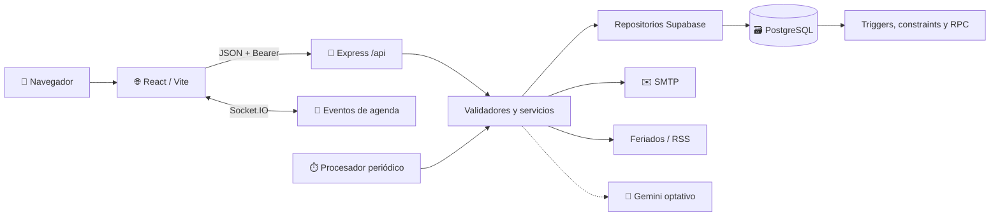
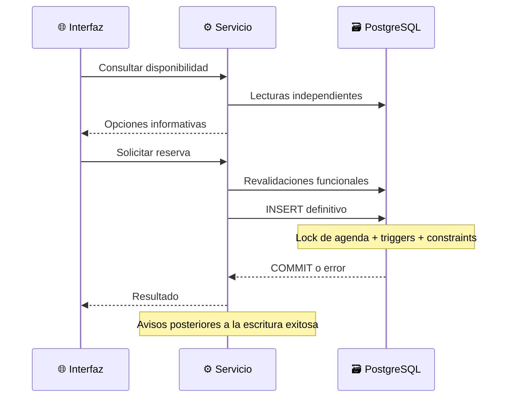

# 🏗️ Arquitectura del sistema

[← Índice](README.md) · [Diagramas](DIAGRAMAS.md) · [Backend](BACKEND.md) · [Frontend](FRONTEND.md) · [Historia Clínica](HISTORIA_CLINICA.md)

## Alcance y componentes

CORA es la interfaz de SAPS Turno. El repositorio contiene dos aplicaciones con dependencias y comandos propios. React consume la API; Express organiza autorización y reglas; los repositorios acceden a Supabase; PostgreSQL conserva integridad y operaciones transaccionales.

No hay un servidor de colas independiente en el código actual. El mismo proceso Node inicia HTTP, Socket.IO y el procesador periódico. Las funciones SQL coordinan los trabajos persistentes cuando corresponde.

## Responsabilidad de cada capa

| Capa | Responsabilidad | No debe suponerse |
| --- | --- | --- |
| Rutas | Método, URL, middleware y controller | Que la ruta por sí sola agote el control de acceso |
| Middleware | Sesión, rol, alcance inicial, errores | Que el frontend conceda permisos |
| Validators | Formato, campos permitidos, límites | Que una entrada válida tenga autorización |
| Controllers | Adaptación de HTTP al servicio y respuesta | Que todos los módulos tengan idéntico envelope |
| Services | Política, coordinación, alcance y reglas | Que varias llamadas Supabase formen una transacción |
| Repositories | Lecturas, escrituras y RPC | Que un SELECT previo reserve un recurso |
| PostgreSQL | FK, CHECK, exclusiones, locks y triggers | Que un archivo SQL ya esté aplicado |
| React | Presentación, navegación y estado de interacción | Que ocultar un botón sea seguridad |

## Ciclo de vida del backend

[server.ts](../backend/src/server.ts) crea el servidor HTTP a partir de [app.ts](../backend/src/app.ts), inicia Socket.IO y el procesador de notificaciones, al que entrega la revisión periódica del calendario. SIGTERM y SIGINT cierran el servidor y esperan las tareas gestionadas por el procesador.

En `app.ts` se aplican Helmet, CORS, el parser específico del chatbot, JSON general de 1 MB, Morgan, `/api`, 404 y errores. CORS refleja actualmente el origen con credenciales; no es una lista cerrada basada en `FRONTEND_URL`.

## Límites transaccionales

La unidad atómica no es toda la solicitud HTTP. La reserva definitiva y sus triggers pertenecen a una transacción; los correos y eventos posteriores no. Una confirmación asistida procesa cada turno por separado.

## Decisiones relevantes

- Fecha civil de agenda: `America/Argentina/Buenos_Aires`; instantes de turnos: `TIMESTAMPTZ`.
- Identidad del actor y paciente atendido son conceptos diferentes.
- Los históricos no se filtran indiscriminadamente por vigencia actual.
- El lock de agenda es global: favorece una regla compartida antes que particionar por profesional o salita.
- La disponibilidad consulta SAPS; no depende de una petición externa en cada reserva.
- Las integraciones externas se aíslan en servicios/repositorios y no conceden acceso directo a pacientes.

## Lectura del código

Empezar por [routes/index.ts](../backend/src/routes/index.ts) y [AppRoutes.tsx](../frontend/src/routes/AppRoutes.tsx). Seguir luego controller → service → repository → SQL. Los archivos de nombre parecido no deben considerarse intercambiables: confirmar sus imports y consumidores en el [inventario](INVENTARIO_CODIGO.md).

