# 🗄️ Modelo de datos

[← Volver al Índice](README.md) · [Diagramas](DIAGRAMAS.md) · [Historia Clínica](HISTORIA_CLINICA.md) · [Diccionario SQL](DICCIONARIO_SQL.md) · [Migraciones](MIGRACIONES.md)

PostgreSQL alojado en Supabase conserva los datos, índices, triggers y restricciones relacionales. La API administra su propia autenticación y autorización mediante JWT y RBAC; el modelo de usuarios y roles de CORA no debe confundirse con Supabase Auth.

---

## Relaciones principales del sistema

El siguiente diagrama resume las relaciones estructurales clave entre los módulos de identidad, recursos territoriales, agenda de turnos e historia clínica electrónica.

```mermaid
erDiagram
    PERSONAS ||--o| USUARIOS : "cuenta de acceso"
    PERSONAS ||--o| PACIENTES : "perfil paciente"
    PERSONAS ||--o| PROFESIONALES : "perfil profesional"
    PERSONAS ||--o| TUTORES : "perfil tutor"

    ROLES ||--o{ USUARIOS : "asigna perfil"
    USUARIOS ||--o{ USUARIO_SALITA : "alcance territorial"
    SALITAS ||--o{ USUARIO_SALITA : "sede autorizada"

    ZONAS ||--o{ BARRIOS : "agrupa"
    BARRIOS ||--o{ SALITA_BARRIOS : "cobertura territorial"
    SALITAS ||--o{ SALITA_BARRIOS : "cubre barrio"

    PACIENTES ||--o{ PACIENTE_TUTORES : "autoriza tutela"
    TUTORES ||--o{ PACIENTE_TUTORES : "representa a"
    PACIENTES ||--o{ SOLICITUDES_VINCULACION : "vinculación solicitada"

    PROFESIONALES ||--o{ PROFESIONAL_SALITA : "atiende en salita"
    SALITAS ||--o{ PROFESIONAL_SALITA : "recibe profesional"
    PROFESIONALES ||--o{ PROFESIONAL_ESPECIALIDAD : "ejerce especialidad"
    ESPECIALIDADES ||--o{ PROFESIONAL_ESPECIALIDAD : "habilita matrícula"

    PROFESIONALES ||--o{ HORARIOS_ATENCION : "configura franja"
    HORARIOS_ATENCION o|--o{ TURNOS : "origina reserva"
    PACIENTES ||--o{ TURNOS : "recibe turno"
    SALITAS ||--o{ TURNOS : "sede del turno"
    ESTADOS_TURNO ||--o{ TURNOS : "clasifica estado"
    TURNOS ||--o{ HISTORIAL_TURNOS : "audita cambios"
    PACIENTES ||--o{ SANCIONES : "restringe inasistencias"

    PACIENTES ||--|| HISTORIAS_CLINICAS : "expediente único (1:1)"
    HISTORIAS_CLINICAS ||--o{ ANTECEDENTES_CLINICOS : "antecedentes médicos"
    HISTORIAS_CLINICAS ||--o{ ALERGIAS_PACIENTE : "alergias registradas"
    HISTORIAS_CLINICAS ||--o{ CONSULTAS_MEDICAS : "atenciones registradas"
    TURNOS ||--o| CONSULTAS_MEDICAS : "vincula acto clínico"
    PROFESIONALES ||--o{ CONSULTAS_MEDICAS : "firma atención"

    CONSULTAS_MEDICAS ||--o{ DIAGNOSTICOS_CLINICOS : "diagnostica"
    CONSULTAS_MEDICAS ||--o{ EVOLUCIONES_CLINICAS : "evoluciona nota"
    CONSULTAS_MEDICAS ||--o{ TRATAMIENTOS_CLINICOS : "prescribe"
    CONSULTAS_MEDICAS ||--o{ ESTUDIOS_CLINICOS : "ordena prácticas"

    PACIENTES ||--o{ DERIVACIONES_AUTORIZACIONES_CLINICAS : "derivación inter-salita"
    PACIENTES ||--o{ AUDITORIA_CLINICA : "trazabilidad inmutable"
    USUARIOS ||--o{ BORRADORES_FORMULARIO_CLINICO : "autoguardado temporal"
```

---

## Familias de tablas

| Familia | Tablas y propósito |
| --- | --- |
| 🔐 **Identidad y acceso** | `personas`, `usuarios`, `roles`, `permisos`, `rol_permisos`, `usuario_identidades`, `sesiones_refresh`, `tokens_recuperacion`, `tokens_verificacion_email` |
| 🏥 **Territorio y cobertura** | `zonas`, `barrios`, `salitas`, `salita_barrios`, `usuario_salita` |
| 👥 **Atención y representación** | `pacientes`, `tutores`, `paciente_tutores`, `paciente_tutores_historial`, `solicitudes_vinculacion` |
| 🩺 **Oferta y recursos** | `especialidades`, `profesionales`, `profesional_especialidad`, `profesional_salita`, `horarios_atencion` |
| 📅 **Agenda y turnos** | `bloqueos_agenda`, `cierres_calendario`, `calendario_sincronizacion`, `estados_turno`, `turnos`, `historial_turnos`, `sanciones` |
| 📋 **Historia clínica electrónica** | `historias_clinicas`, `antecedentes_clinicos`, `alergias_paciente`, `consultas_medicas`, `diagnosticos_clinicos`, `evoluciones_clinicas`, `tratamientos_clinicos`, `estudios_clinicos`, `derivaciones_autorizaciones_clinicas`, `derivaciones_autorizaciones_historial`, `borradores_formulario_clinico` |
| 🛡️ **Auditoría clínica inmutable** | `auditoria_clinica`, `auditoria_accesos_auditoria` |
| 📢 **Comunicaciones** | `notificaciones`, `notificacion_envios` |
| 📰 **Publicaciones** | `categorias_publicas`, `noticias_publicas` |
| ⚙️ **Transversales** | `configuracion`, `auditoria` |

---

## Identidad y relaciones

`personas` centraliza la identidad física y civil (DNI, nombres, datos de contacto); `usuarios` representa la credencial de autenticación en la plataforma. Pacientes, tutores y profesionales referencian a `personas`. Un paciente puede estar empadronado en el sistema sin poseer una cuenta de acceso. Asimismo, un usuario (por ejemplo un tutor o recepcionista) puede gestionar un turno o una autorización para un paciente distinto.

Las tablas de asociación contienen estado (`activo`) y vigencia temporal (`fecha_desde` y `fecha_hasta`). La presencia de una clave foránea no equivale a una habilitación operativa: se valida siempre el intervalo de vigencia para la fecha de la consulta o reserva solicitada.

---

## Integridad de agenda y concurrencia

Los timestamps de los turnos se gestionan con zona horaria (`America/Argentina/Buenos_Aires`). Se implementan restricciones de exclusión GiST (`EXCLUDE USING gist`) que impiden a nivel de motor de base de datos la superposición de turnos para un mismo profesional o un mismo paciente en franjas solapadas.

Los horarios tienen día semanal ISO (1 a 7), duración entre 5 y 240 minutos y cupos positivos. Los bloqueos de agenda y cierres institucionales suspenden la disponibilidad. Los procedimientos transaccionales (RPC) agrupan validaciones y escrituras para asegurar atomicidad.

---

## Integridad e inmutabilidad clínica

1. **Expediente Único**: La relación entre `pacientes` e `historias_clinicas` es estrictamente 1:1 (`UNIQUE id_paciente`).
2. **Inmutabilidad de lo Firmado**:
   - Una consulta médica en estado `FIRMADA` (`firmada_en IS NOT NULL`) no admite modificaciones directas.
   - Si se requiere actualizar el curso clínico, se agrega una nueva nota en `evoluciones_clinicas`.
   - Si una evolución previa contenía un error u omisión involuntaria, se rectifica mediante una nueva fila marcada con `es_correccion = TRUE`, vinculada por `id_evolucion_origen`, preservando inalterable la nota histórica original.
3. **Bloqueo Físico de Eliminaciones**:
   - Triggers `BEFORE DELETE` y `BEFORE UPDATE` en `auditoria_clinica` y `auditoria_accesos_auditoria` impiden el borrado o alteración de registros de auditoría mediante excepciones de base de datos.
4. **Borradores con Control Optimista**:
   - `borradores_formulario_clinico` permite el autoguardado de la consulta en curso con una columna `version` para evitar colisiones entre sesiones concurrentes.
