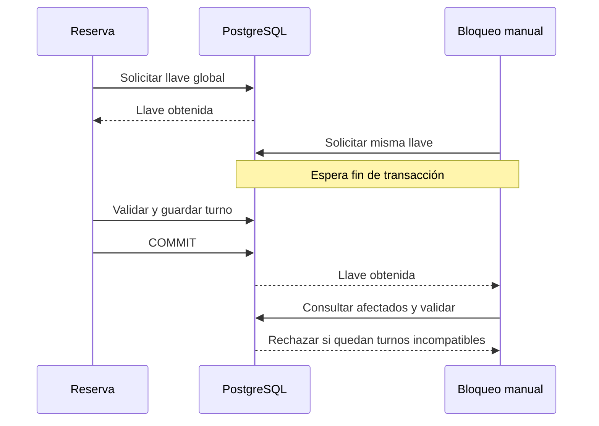

# 🔒 Concurrencia de agenda

[Índice](README.md) · [Migraciones](MIGRACIONES.md) · [Reprogramación](agenda-reprogramacion-asistida.md)

## Problema y mecanismo

Dos solicitudes pueden consultar disponibilidad libre y luego intentar reservar o bloquear la misma franja. Las consultas previas de la API no forman una transacción con la escritura. La protección definitiva reside en PostgreSQL.

La migración de impacto introduce `pg_advisory_xact_lock(20261103, 1)` mediante triggers `BEFORE STATEMENT` para escrituras de turnos, horarios y bloqueos. Los cierres se incorporan mediante su migración. Las RPC de escritura toman la misma llave antes de bloquear filas. Es un bloqueo global de agenda, liberado al finalizar la transacción.

## Capas complementarias

| Protección | Responsabilidad |
| --- | --- |
| Llave transaccional global | Ordenar escrituras de recursos diferentes que comparten agenda |
| Bloqueo de fila del horario | Proteger configuración y evaluación de cupo durante reserva |
| `FOR SHARE` de profesional-salita | Evitar cambios concurrentes de esa relación durante validación |
| Exclusiones GiST | Evitar superposición de paciente y profesional |
| Índice único parcial | Aplicar restricción paciente/especialidad según estado |
| Versión del turno | Rechazar edición basada en una versión anterior |
| RPC de escritura | Agrupar cambio, historial y auditoría según operación |

Los bloqueos de fila aislados no resolverían una carrera entre filas distintas de turnos y bloqueos. La llave compartida es parte indispensable del diseño.

## Cierres importados

Un cierre manual no puede guardarse dejando turnos afectados sin resolver. La importación autorizada por un lease de sincronización tiene otra política: permite incorporar el cierre con reservas anteriores pendientes de gestión. Si el cierre se guarda primero, la nueva reserva se rechaza; si la reserva se guarda primero, puede quedar afectada por la importación. Esa coexistencia es deliberada.

La evaluación de afectados considera turnos que ocupan agenda y no han terminado, además del alcance territorial, profesional, especialidad y superposición temporal. No convierte toda coexistencia histórica en un conflicto.

## Alcance de la conclusión

El análisis estático presupone las migraciones en orden y el aislamiento habitual `READ COMMITTED`. No certifica una base externa ni transacciones personalizadas bajo otros niveles de aislamiento. La llave global simplifica la consistencia, pero serializa escrituras incluso de salitas distintas; medir antes de rediseñarla.

Los correos y eventos Socket.IO posteriores al commit no son parte de la transacción SQL. La reprogramación por lotes informa resultados parciales y debe permitir revisar los fallos individualmente.

Fuentes: [impacto](../backend/src/BBDD/20261103_agenda_impacto.sql), [escritura](../backend/src/BBDD/20261103_agenda_escritura.sql), [cierres](../backend/src/BBDD/20261107_cierres_calendario.sql), [sincronización](../backend/src/BBDD/20261108_argentinadatos.sql), [vigencia](../backend/src/BBDD/20261109_profesional_salita_vigencia.sql).
