# 📊 Diagramas del Sistema · CORA / SAPS Turno

[← Volver al Índice General](README.md) · [Arquitectura](ARQUITECTURA.md) · [Base de Datos](BASE_DE_DATOS.md) · [Historia Clínica](HISTORIA_CLINICA.md)

Este documento centraliza los diagramas formales de ingeniería de software para **CORA · SAPS Turno**: diagramas de casos de uso por actor, diagramas de secuencia de los flujos críticos del negocio, diagramas de arquitectura y diagramas entidad-relación de la base de datos PostgreSQL.

---

## 🧭 Índice de Diagramas

1. [🏛️ Diagrama de Arquitectura Global](#1-arquitectura-global)
2. [👥 Diagramas de Casos de Uso](#2-diagramas-de-casos-de-uso)
   - [2.1 Pacientes y Tutores](#21-casos-de-uso-paciente-y-tutor)
   - [2.2 Profesionales de la Salud](#22-casos-de-uso-profesional-de-salud)
   - [2.3 Administración de Salita y Recepción](#23-casos-de-uso-administración-de-salita-y-recepción)
   - [2.4 Super Administrador](#24-casos-de-uso-super-administrador)
3. [⏱️ Diagramas de Secuencia](#3-diagramas-de-secuencia)
   - [3.1 Reserva y Validación Atómica de Turno](#31-reserva-y-validación-atómica-de-turno)
   - [3.2 Reprogramación Asistida ante Cierres o Ausencias](#32-reprogramación-asistida-ante-cierres-o-ausencias)
   - [3.3 Atención Médica, Borrador y Firma de Consulta Clínica](#33-atención-médica-borrador-y-firma-de-consulta-clínica)
   - [3.4 Derivación Clínica y Autorización entre Salitas](#34-derivación-clínica-y-autorización-entre-salitas)
   - [3.5 Autenticación JWT y Verificación de Identidad](#35-autenticación-jwt-y-verificación-de-identidad)
4. [🗄️ Diagramas de Base de Datos (Entidad-Relación)](#4-diagramas-de-base-de-datos-entidad-relación)
   - [4.1 Núcleo de Identidad, Cuentas y Representación](#41-identidad-cuentas-y-representación)
   - [4.2 Estructura Territorial, Recursos y Horarios](#42-estructura-territorial-recursos-y-horarios)
   - [4.3 Agenda, Turnos, Cierres y Sanciones](#43-agenda-turnos-cierres-y-sanciones)
   - [4.4 Historia Clínica Electrónica, Borradores y Auditoría Clínica](#44-historia-clínica-electrónica-y-auditoría)

---

## 1. 🏛️ Arquitectura Global

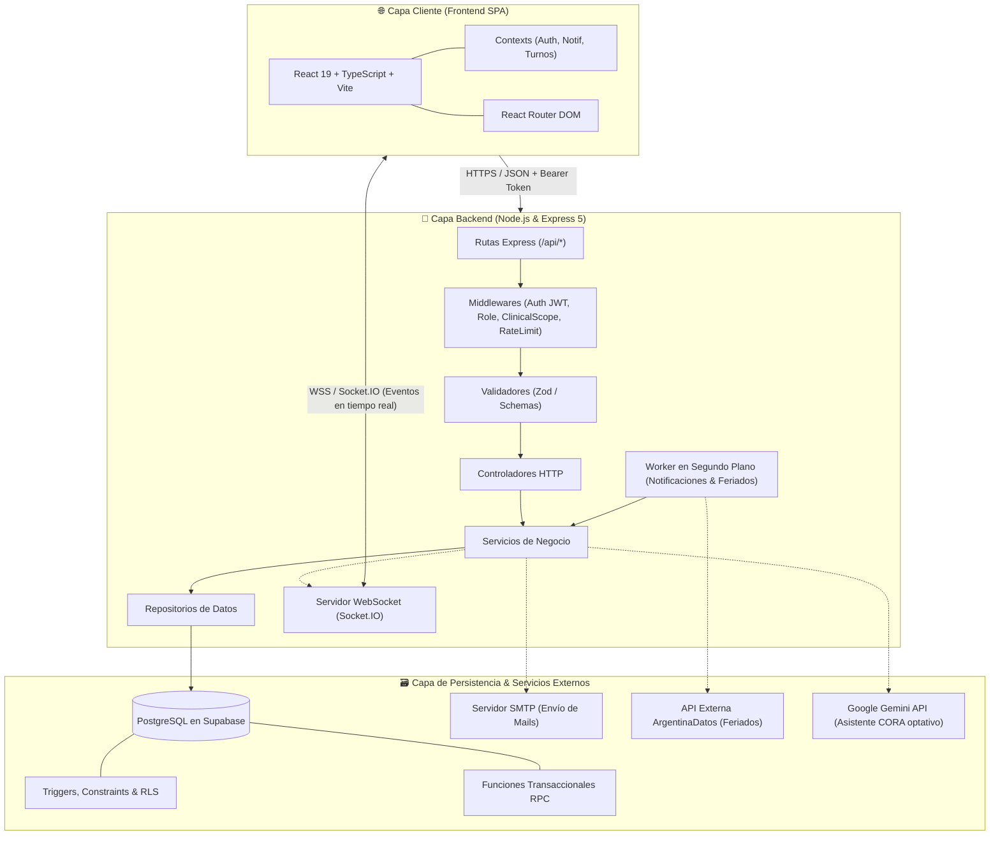

---

## 2. 👥 Diagramas de Casos de Uso

### 2.1 Casos de Uso: Paciente y Tutor

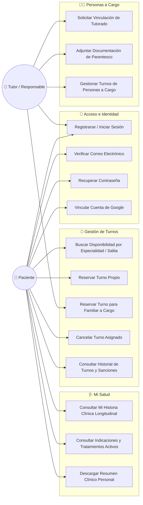

---

### 2.2 Casos de Uso: Profesional de Salud

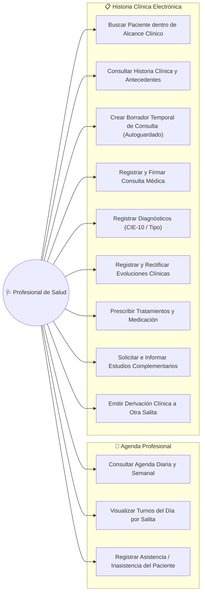

---

### 2.3 Casos de Uso: Administración de Salita y Recepción

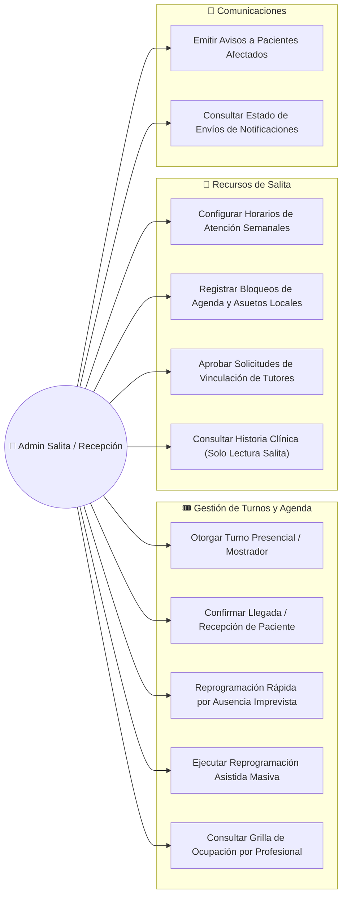

---

### 2.4 Casos de Uso: Super Administrador

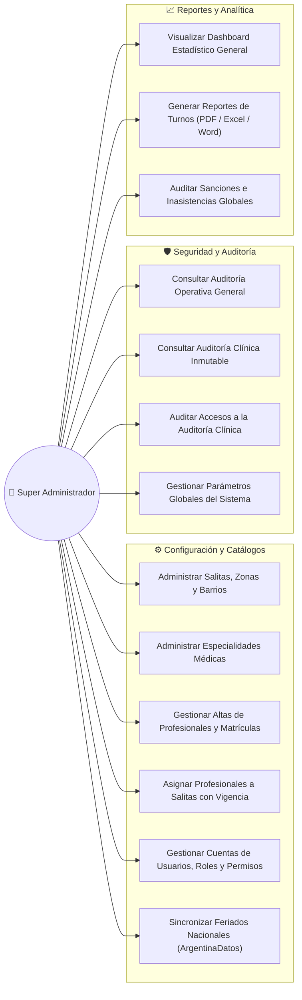

---

## 3. ⏱️ Diagramas de Secuencia

### 3.1 Reserva y Validación Atómica de Turno

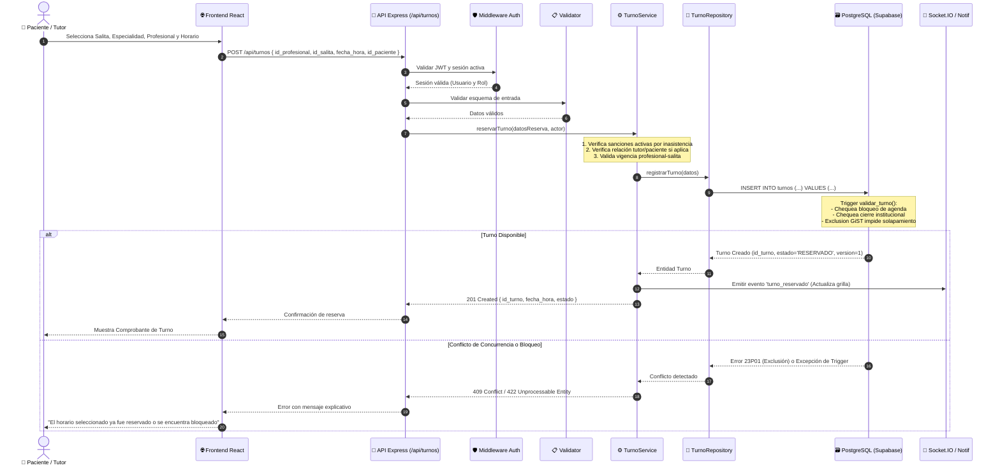

---

### 3.2 Reprogramación Asistida ante Cierres o Ausencias

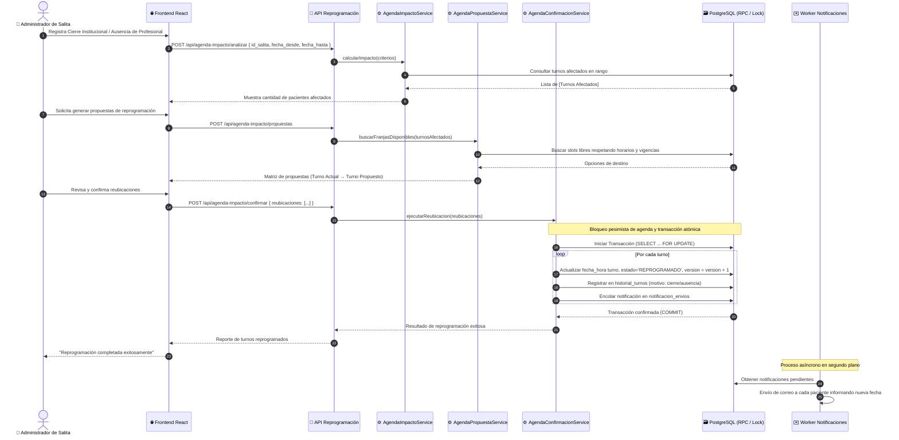

---

### 3.3 Atención Médica, Borrador y Firma de Consulta Clínica

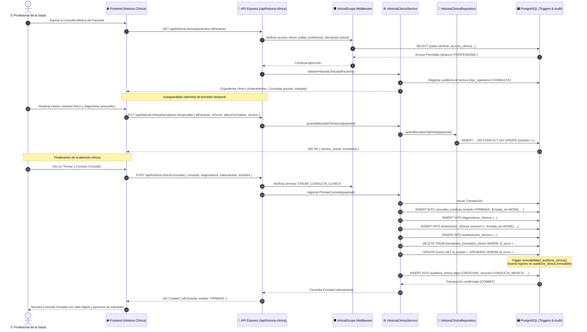

---

### 3.4 Derivación Clínica y Autorización entre Salitas

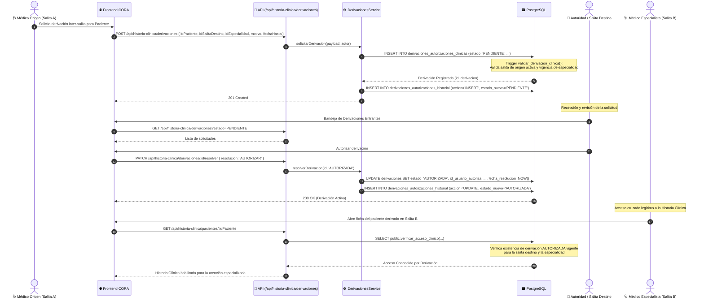

---

### 3.5 Autenticación JWT y Verificación de Identidad

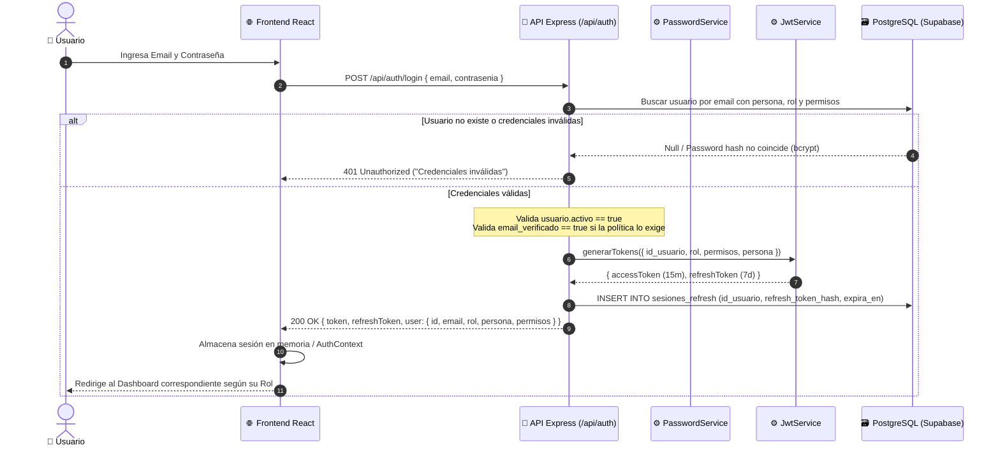

---

## 4. 🗄️ Diagramas de Base de Datos (Entidad-Relación)

### 4.1 Núcleo de Identidad, Cuentas y Representación

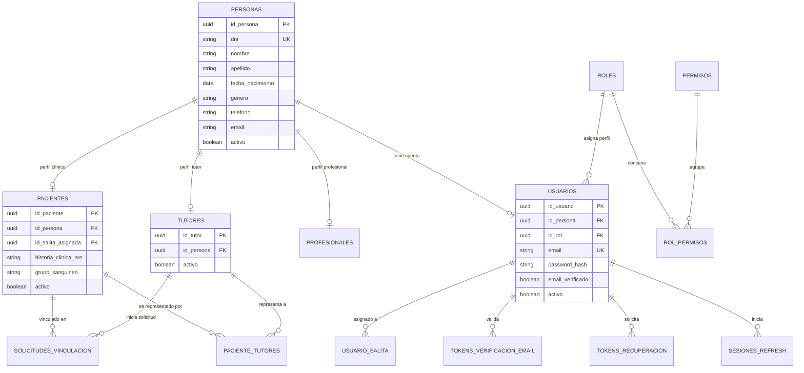

---

### 4.2 Estructura Territorial, Recursos y Horarios

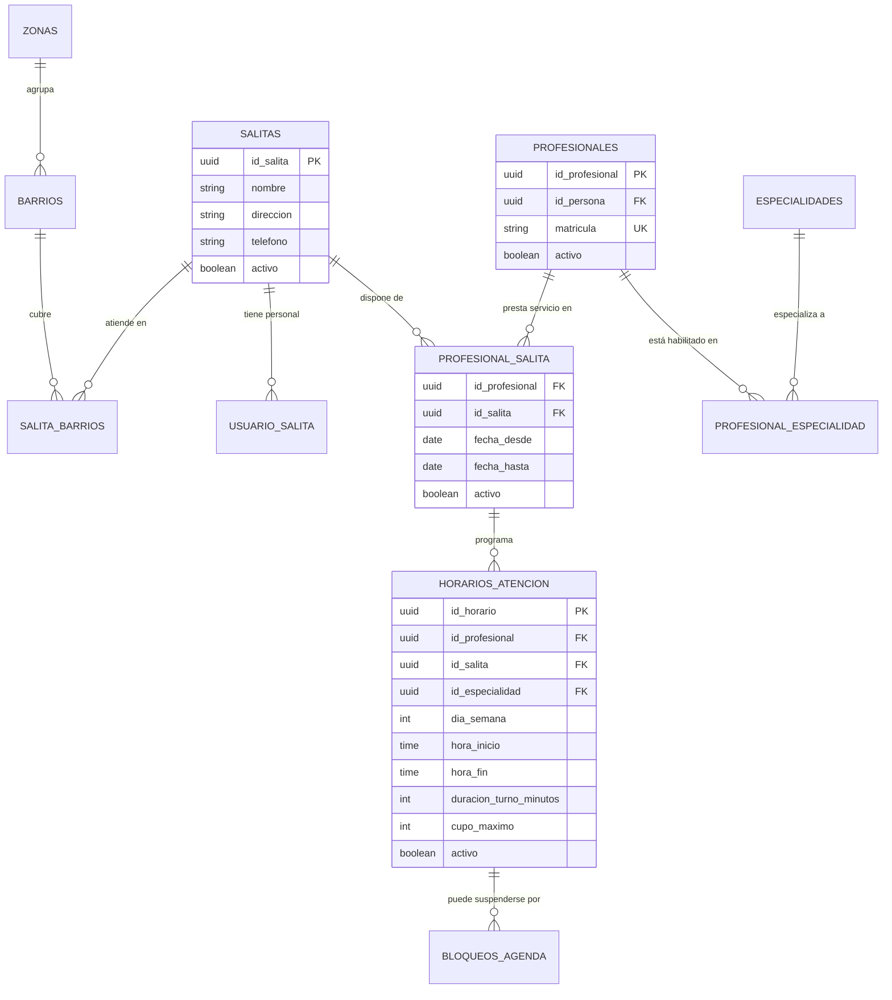

---

### 4.3 Agenda, Turnos, Cierres y Sanciones

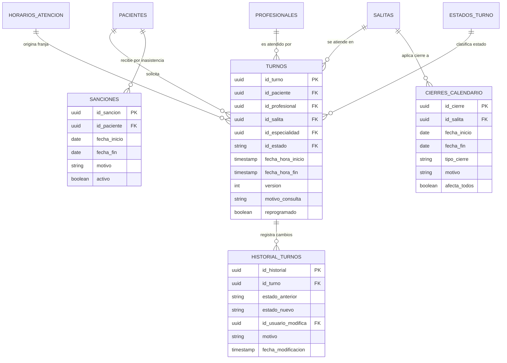

---

### 4.4 Historia Clínica Electrónica, Borradores y Auditoría

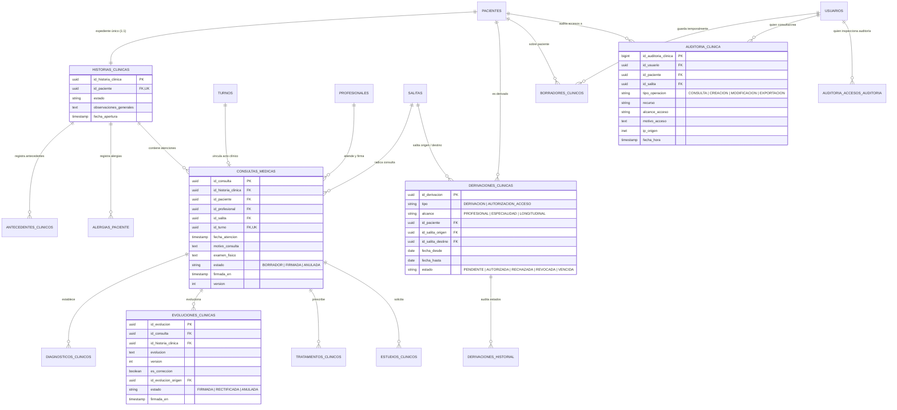

---

> [!NOTE]
> Todos los diagramas representados en este documento corresponden a la arquitectura estática e implementaciones activas en el repositorio. Para inspeccionar las tablas en formato DDL, consulte el [Diccionario SQL](DICCIONARIO_SQL.md) y el módulo específico de [Historia Clínica](HISTORIA_CLINICA.md).
