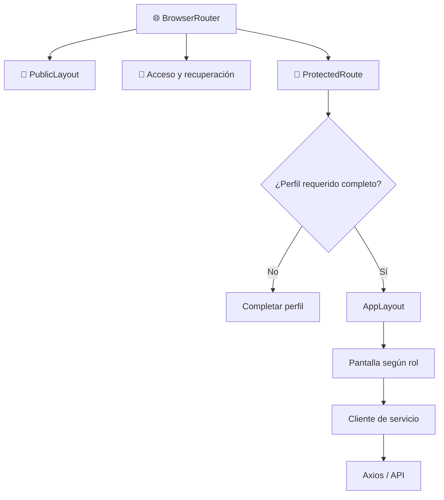

# 🌐 Frontend, navegación y estado

| [← Índice](README.md) · [Manual de usuario](MANUAL_USUARIO.md) · [Diagramas](DIAGRAMAS.md) · [Historia Clínica](HISTORIA_CLINICA.md) · [API](API.md)

## Aplicación

React 19, TypeScript, Vite, React Router, Bootstrap y CSS propio. [AppRoutes.tsx](../frontend/src/routes/AppRoutes.tsx) utiliza `BrowserRouter`, carga diferida de páginas y `Suspense`. La portada tiene `PublicLayout`; el área interna usa `AppLayout`.

## Mapa de pantallas

| Área | Rutas principales |
| --- | --- |
| Pública | `/`, `/noticias/:id` |
| Acceso | `/login`, `/registro`, `/recuperar-contrasena`, `/restablecer-contrasena`, `/verificar-email`, `/verificar-codigo` |
| Compartida | `/panel`, `/mi-perfil`, `/mis-notificaciones`, `/privacidad`, `/asistente` |
| Paciente | `/solicitar-turno`, `/mis-turnos`, `/mis-turnos/:id`, `/personas-a-cargo`, `/mi-historia` |
| Profesional | `/mi-agenda`, `/mis-pacientes`, `/mis-horarios`, `/historia-clinica`, `/historia-clinica/nueva`, `/historia-clinica/derivaciones` |
| Historia Clínica | `/historia-clinica/pacientes/:id`, `/historia-clinica/consultas/:id`, `/historia-clinica/auditoria` |
| Administración | `/pacientes`, `/profesionales`, `/turnos`, `/reportes`, `/administracion`, `/solicitudes-vinculacion` |
| Configuración | `/configuracion/horarios`, `/configuracion/bloqueos`, `/configuracion/cierres`, `/configuracion/parametros` |
| Territorio | `/salitas`, `/configuracion/zonas`, `/configuracion/barrios`, `/configuracion/cobertura` |
| Comunicación | `/notificaciones`, `/notificaciones/programadas`, `/notificaciones/nueva`, `/contenido` |

La tabla resume navegación, no concede permisos. Las rutas anidadas de `AppRoutes` determinan el acceso de interfaz. `RECEPCION` no tiene un panel independiente ni el acceso general a `/panel`; en el frontend solo tiene habilitada la ruta `/configuracion/bloqueos`. El backend expone más operaciones para ese rol, sujetas a sus propios controles y alcance: una ruta de API no implica que exista una pantalla equivalente.

## Sesión y llamadas

[api.ts](../frontend/src/services/api.ts) utiliza `VITE_API_URL`, agrega Bearer y, ante un 401, intenta renovar la sesión una vez por solicitud. Si falla la renovación, limpia la sesión. No aplica ese reintento a cualquier error ni garantiza idempotencia de escrituras.

[auth-storage.ts](../frontend/src/utils/auth-storage.ts) guarda access token, refresh token y usuario en localStorage. `saps-session` informa cambios locales. El contexto de autenticación y las rutas protegidas coordinan la interfaz, pero la autorización final permanece en el servidor.

## Organización de componentes

- `pages`: coordinación de carga, filtros, formularios y navegación.
- `components/turnos`: selección, impacto, revisión de destinos y calendario.
- `components/profesionales`: formularios, cuentas y vigencias.
- `components/ui`: controles y paneles reutilizables.
- `components/public`: portada y secciones con estados de carga independientes.
- `components/chatbot`: asistente, sesión local y presentación.
- `context`: autenticación y estado compartido; consultar el inventario para los proveedores existentes.
- `services`: contratos Axios por módulo; `types`: datos que consume la UI.

## Agenda y actualización

La interfaz puede refrescar disponibilidad y recibir eventos de agenda. Ninguna actualización visual retiene un cupo. Si la reserva devuelve conflicto, volver a consultar opciones. En reprogramación asistida el usuario revisa los destinos y recibe resultados por turno.

`agenda-display.ts` presenta fechas argentinas. Para asignaciones y filtros por día no utilizar el día UTC de `toISOString()` como sustituto de la fecha local.

## Diseño y accesibilidad

Bootstrap, Bootstrap Icons y estilos existentes forman el sistema visual. Conservar estados de carga, vacío, error y éxito. Los formularios deben mantener sus datos cuando una solicitud falla y distinguir deshabilitación visual de autorización. La documentación especializada describe modales, navegación móvil y teclado de cada módulo; no se afirma una certificación global de accesibilidad.

Los diagramas de esta biblioteca usan Mermaid y etiquetas con iconos Unicode, sin depender de una fuente de iconos externa.

## Despliegue

Las variables `VITE_*` se incorporan durante build y son públicas. El hosting debe resolver rutas de la SPA hacia el documento de entrada y permitir conexión a la API. `vite preview` es una previsualización local, no la configuración de producción. No incluir secretos SMTP, Supabase de servidor ni JWT en el frontend.
