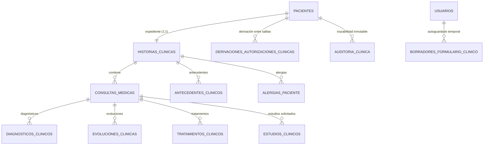
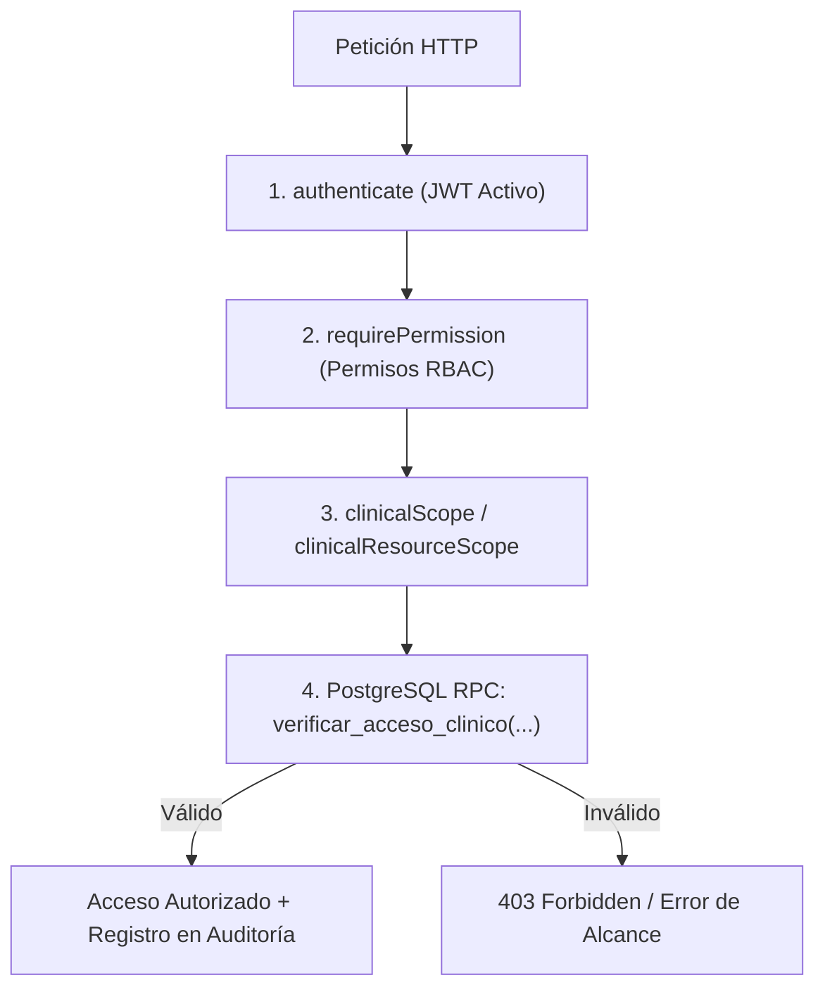

# 🩺 Historia Clínica Electrónica (HCE)

[← Volver al Índice General](README.md) · [Diagramas](DIAGRAMAS.md) · [API y Rutas](API_RUTAS.md) · [Base de Datos](BASE_DE_DATOS.md) · [Seguridad](SEGURIDAD_Y_ACCESO.md)

Este documento describe la arquitectura, modelo relacional, políticas de seguridad y contratos de la **Historia Clínica Electrónica (HCE)** en **CORA · SAPS Turno**.

---

## 🎯 Objetivos y Principios del Módulo

1. **Expediente Longitudinal Único**: Cada paciente posee una única historia clínica vinculada a su ficha de persona/paciente en la red municipal de atención primaria.
2. **Seguridad y Confidencialidad por Defecto**:
   - Cabecera HTTP `Cache-Control: no-store` en todas las rutas clínicas para evitar almacenamiento local no autorizado en cachés intermedias o navegadores.
   - Separación estricta de responsabilidades (*Principio de Privilegio Mínimo*).
   - Inmutabilidad estricta: Los actos clínicos firmados no admiten eliminación ni edición física destructiva; las correcciones se efectúan mediante **rectificaciones trazables** con versionado.
3. **Control de Alcance Clínico (*Clinical Scope*)**:
   - El profesional solo accede a pacientes vinculados a su salita de atención vigente o asignados mediante **derivación / autorización inter-salita activa**.
   - Los roles `ADMIN_SALITA` y `RECEPCION` poseen permiso de lectura exclusivamente asistencial para pacientes de su propia salita, sin facultad de registrar diagnósticos, evoluciones o firmas médicas.
   - El `PACIENTE` accede únicamente a su propio historial clínico y al de sus personas a cargo autorizadas a través del portal autogestionado.
4. **Auditoría Clínica Inmutable e Independiente**:
   - Todo acceso o modificación clínica genera un registro no modificable ni eliminable protegido por triggers SQL en PostgreSQL.
   - Las auditorías de inspección (quién audita a los auditores) se almacenan en una tabla independiente (`auditoria_accesos_auditoria`) para evitar loops o recursiones.

---

## 🧩 Modelo Relacional y Entidades



### 1. `historias_clinicas`
Expediente longitudinal único del paciente.
- **`id_historia_clinica`** (UUID, PK): Identificador único.
- **`id_paciente`** (UUID, FK, UNIQUE): Vínculo 1:1 con la tabla `pacientes`.
- **`estado`** (VARCHAR(20)): `ACTIVA`, `INACTIVA`, `ARCHIVADA`.
- **`observaciones_generales`** (TEXT): Notas clínicas estructurales o de alerta general.
- **`fecha_apertura`** (TIMESTAMPTZ): Momento de alta formal de la historia clínica.

### 2. `consultas_medicas`
Acto médico de atención presencial, asociado a un turno programado o a una atención médica espontánea por guardia/demanda.
- **`id_consulta`** (UUID, PK): Identificador único.
- **`id_historia_clinica`** (UUID, FK): Vínculo al expediente del paciente.
- **`id_profesional`** (UUID, FK): Médico o profesional actuante.
- **`id_salita`** (UUID, FK): Salita donde se realiza la atención.
- **`id_especialidad`** (UUID, FK): Especialidad médica brindada.
- **`id_turno`** (UUID, FK, UNIQUE, Opcional): Turno asignado (si la atención proviene de agenda).
- **`id_autorizacion_clinica`** (UUID, FK, Opcional): Derivación autorizada inter-salita que respalda el acto.
- **`motivo_consulta`** (TEXT): Motivo manifestado por el paciente.
- **`sintomas`**, **`examen_fisico`**, **`observaciones`** (TEXT): Hallazgos clínicos.
- **`estado`** (VARCHAR(20)): `BORRADOR`, `FIRMADA`, `ANULADA`.
- **`firmada_en`** (TIMESTAMPTZ): Sello de tiempo de la firma profesional. Bloquea toda edición posterior.
- **`motivo_anulacion`** / **`anulada_en`** (TEXT/TIMESTAMPTZ): En caso de anulación administrativa o de error de carga en borrador.
- **`version`** (INTEGER): Control de concurrencia optimista (inicia en 1).

### 3. `diagnosticos_clinicos`
Diagnósticos codificados o narrativos establecidos en el marco de la consulta.
- **`id_diagnostico`** (UUID, PK)
- **`id_consulta`** (UUID, FK): Consulta médica asociada.
- **`codigo`** (VARCHAR(30)): Código de clasificación diagnóstica (CIE-10 u homólogo).
- **`descripcion`** (VARCHAR(300)): Descripción clara del diagnóstico.
- **`tipo`** (VARCHAR(20)): `PRESUNTIVO`, `CONFIRMADO`, `DIFERENCIAL`, `PRINCIPAL`, `SECUNDARIO`, `DESCARTADO`.
- **`estado`** (VARCHAR(20)): `ACTIVO`, `RESUELTO`, `DESCARTADO`, `ANULADO`.

### 4. `evoluciones_clinicas`
Seguimiento médico y evolución del paciente. Diseñado bajo el principio de **rectificación trazable**:
- **`id_evolucion`** (UUID, PK)
- **`id_consulta`** (UUID, FK)
- **`evolucion`** (TEXT): Nota de evolución médica.
- **`version`** (INTEGER): Versión correlativa dentro de la consulta.
- **`es_correccion`** (BOOLEAN): Indica si la evolución rectifica una nota anterior.
- **`id_evolucion_origen`** (UUID, FK): Puntero hacia la evolución rectificada (UNIQUE parcial, impide ramas divergentes).
- **`motivo_correccion`** (TEXT): Fundamento clínico de la corrección o rectificación.
- **`estado`** (VARCHAR(20)): `BORRADOR`, `FIRMADA`, `RECTIFICADA`, `ANULADA`.

### 5. `tratamientos_clinicos`
Prescripciones farmacológicas, indicaciones terapéuticas y planes de cuidado.
- **`id_tratamiento`** (UUID, PK)
- **`id_consulta`** (UUID, FK)
- **`medicacion`**, **`dosis`**, **`frecuencia`**, **`duracion`** (VARCHAR)
- **`indicaciones`** (TEXT)
- **`fecha_inicio`** / **`fecha_fin`** (DATE)
- **`estado`** (VARCHAR(20)): `ACTIVO`, `FINALIZADO`, `SUSPENDIDO`, `ANULADO`.

### 6. `estudios_clinicos`
Órdenes y solicitudes de prácticas diagnósticas complementarias (laboratorio, imágenes, etc.).
- **`id_estudio`** (UUID, PK)
- **`id_consulta`** (UUID, FK)
- **`tipo_estudio`**, **`descripcion`** (VARCHAR / TEXT)
- **`estado`** (VARCHAR(20)): `SOLICITADO`, `EN_PROCESO`, `COMPLETADO`, `CANCELADO`.
- **`resultado`** (TEXT): Informe cargado una vez realizada la práctica.
- **`fecha_resultado`** (TIMESTAMPTZ)
- **`id_profesional_informa`** (UUID, FK): Profesional que emite el informe del resultado.

### 7. `antecedentes_clinicos` y `alergias_paciente`
Historial de condiciones crónicas y reacciones adversas:
- **`antecedentes_clinicos`**: Tipos: `PERSONAL`, `FAMILIAR`, `QUIRURGICO`, `PATOLOGICO`, `GINECOLOGICO`, `OTRO`.
- **`alergias_paciente`**: Alérgeno, tipo de reacción, gravedad (`LEVE`, `MODERADA`, `GRAVE`, `DESCONOCIDA`) y estado.

### 8. `derivaciones_autorizaciones_clinicas`
Mecanismo para la atención inter-salitas y acceso cruzado autorizado:
- **`tipo`**: `DERIVACION` o `AUTORIZACION_ACCESO`.
- **`alcance`**: `PROFESIONAL` (médico puntual), `ESPECIALIDAD` (cualquier profesional del área) o `LONGITUDINAL` (lectura completa de antecedentes).
- **`salita_origen`** y **`salita_destino`**: Requiere que sean salitas distintas (`CHECK id_salita_origen <> id_salita_destino`).
- **`estado`**: `PENDIENTE`, `AUTORIZADA`, `RECHAZADA`, `REVOCADA`, `VENCIDA`.
- Posee tabla de auditoría adosada: `derivaciones_autorizaciones_historial`.

### 9. `borradores_formulario_clinico`
Almacenamiento transitorio de autoguardado en backend para evitar pérdida de datos ante interrupciones de conectividad:
- Almacena el estado borrador del formulario en formato JSONB con concurrencia optimista (`version`).
- Posee expiración automática configurable (TTL de 72 horas).
- Se elimina automáticamente al firmar y consolidar la consulta médica formal.

---

## 🛡️ Control de Acceso y Middleware Clínico

El acceso a la historia clínica se rige por un triple anillo de seguridad:



### Permisos Clínicos en el Sistema

| Código de Permiso | Nombre | Roles por Defecto |
| --- | --- | --- |
| `VER_HISTORIA_CLINICA` | Ver historia clínica | `PROFESIONAL`, `ADMIN_SALITA`, `RECEPCION` (estos dos últimos acotados a su salita asignada) |
| `CREAR_CONSULTA_CLINICA` | Crear consulta clínica | `PROFESIONAL` |
| `GESTIONAR_ANTECEDENTES_CLINICOS` | Gestionar antecedentes | `PROFESIONAL` |
| `REGISTRAR_DIAGNOSTICOS` | Registrar diagnósticos | `PROFESIONAL` |
| `REGISTRAR_EVOLUCIONES` | Registrar evoluciones | `PROFESIONAL` |
| `GESTIONAR_TRATAMIENTOS` | Gestionar tratamientos | `PROFESIONAL` |
| `GESTIONAR_ESTUDIOS_CLINICOS` | Gestionar estudios | `PROFESIONAL` |
| `GESTIONAR_DERIVACIONES_CLINICAS` | Gestionar derivaciones | `PROFESIONAL` |
| `VER_AUDITORIA_CLINICA` | Ver auditoría clínica | `SUPER_ADMIN` |

---

## 🔒 Auditoría Inmutable: `auditoria_clinica`

A nivel del motor relacional de PostgreSQL, se implementa una función disparadora que rechaza cualquier sentencia de actualización o eliminación física:

```sql
CREATE OR REPLACE FUNCTION public.inmutabilidad_auditoria_clinica()
RETURNS TRIGGER
LANGUAGE plpgsql AS $$
BEGIN
    RAISE EXCEPTION 'Los registros de auditoría clínica (%) son inmutables y no admiten modificación ni eliminación.', TG_TABLE_NAME;
END;
$$;
```

Cada fila de `auditoria_clinica` registra:
- **`id_usuario`**: Cuenta del operador que realizó la acción.
- **`id_profesional`**: Si aplica, profesional actuante.
- **`id_paciente`**: Paciente consultado o atendido.
- **`id_salita`**: Salita desde la que se origina el acceso.
- **`tipo_operacion`**: `CONSULTA`, `CREACION`, `MODIFICACION`, `CORRECCION` o `EXPORTACION`.
- **`recurso`** y **`id_recurso`**: Entidad afectada (`CONSULTA_MEDICA`, `HISTORIA_CLINICA`, etc.).
- **`fecha_hora`**: Timestamp real del servidor al momento del acceso.
- **`fecha_acto_clinico`**: Fecha médica del acto registrado.
- **`ip_origen`**: Dirección IP de la petición.

Para auditar quién inspecciona los registros de auditoría clínica, existe la tabla secundaria inmutable **`auditoria_accesos_auditoria`**.

---

## 📡 Catálogo de Rutas de la API (`/api/historia-clinica`)

| Método | Endpoint | Permiso Requerido | Descripción |
| --- | --- | --- | --- |
| `GET` | `/api/historia-clinica/mi-historia` | Rol `PACIENTE` | Consulta del propio historial clínico del paciente autenticado o sus tutelados. |
| `GET` | `/api/historia-clinica/contexto` | Autenticado | Obtiene salitas y especialidades vigentes del profesional. |
| `GET` | `/api/historia-clinica/pacientes` | `VER_HISTORIA_CLINICA` | Buscador de pacientes habilitados dentro del alcance asistencial. |
| `GET` | `/api/historia-clinica/pacientes/:idPaciente` | `VER_HISTORIA_CLINICA` | Consulta del expediente longitudinal completo del paciente. |
| `GET` | `/api/historia-clinica/pacientes/:idPaciente/antecedentes` | `VER_HISTORIA_CLINICA` | Consulta de antecedentes personales, familiares y patológicos. |
| `GET` | `/api/historia-clinica/pacientes/:idPaciente/alergias` | `VER_HISTORIA_CLINICA` | Consulta de alergias registradas del paciente. |
| `GET` | `/api/historia-clinica/consultas/:idConsulta` | `VER_HISTORIA_CLINICA` | Detalle específico de una consulta médica. |
| `GET` | `/api/historia-clinica/consultas/:idConsulta/diagnosticos` | `VER_HISTORIA_CLINICA` | Diagnósticos vinculados a una consulta médica. |
| `GET` | `/api/historia-clinica/consultas/:idConsulta/evoluciones` | `VER_HISTORIA_CLINICA` | Notas de evolución de la consulta. |
| `GET` | `/api/historia-clinica/consultas/:idConsulta/tratamientos` | `VER_HISTORIA_CLINICA` | Tratamientos y prescripciones de la consulta. |
| `GET` | `/api/historia-clinica/consultas/:idConsulta/estudios` | `VER_HISTORIA_CLINICA` | Estudios complementarios solicitados en la consulta. |
| `POST` | `/api/historia-clinica/consultas` | `CREAR_CONSULTA_CLINICA` | Creación de nueva consulta médica en borrador o directa. |
| `PATCH` | `/api/historia-clinica/consultas/:idConsulta` | `CREAR_CONSULTA_CLINICA` | Actualización de consulta médica en estado BORRADOR. |
| `POST` | `/api/historia-clinica/consultas/:idConsulta/firmar` | `CREAR_CONSULTA_CLINICA` | Firma definitiva y cierre inmutable de la consulta médica. |
| `POST` | `/api/historia-clinica/consultas/:idConsulta/anular` | `CREAR_CONSULTA_CLINICA` | Anulación motivada de una consulta en borrador. |
| `GET` | `/api/historia-clinica/borradores-temporales` | `CREAR_CONSULTA_CLINICA` | Recupera el borrador temporal de autoguardado para un paciente/turno. |
| `PUT` | `/api/historia-clinica/borradores-temporales` | `CREAR_CONSULTA_CLINICA` | Guarda o actualiza el borrador temporal con control optimista de versión. |
| `DELETE` | `/api/historia-clinica/borradores-temporales` | `CREAR_CONSULTA_CLINICA` | Descarta y elimina el borrador temporal activo. |
| `POST` | `/api/historia-clinica/consultas/:idConsulta/evoluciones` | `REGISTRAR_EVOLUCIONES` | Registra una nueva evolución médica sobre consulta firmada. |
| `POST` | `/api/historia-clinica/evoluciones/:idEvolucion/rectificar` | `REGISTRAR_EVOLUCIONES` | Rectifica una evolución previa conservando el hilo histórico inmutable. |
| `PATCH` | `/api/historia-clinica/estudios/:idEstudio/estado` | `GESTIONAR_ESTUDIOS_CLINICOS` | Modifica el estado del estudio clínico. |
| `POST` | `/api/historia-clinica/estudios/:idEstudio/informar` | `GESTIONAR_ESTUDIOS_CLINICOS` | Carga el informe de resultados del estudio médico. |
| `GET` | `/api/historia-clinica/derivaciones` | `GESTIONAR_DERIVACIONES_CLINICAS`| Lista derivaciones inter-salitas (solicitadas / recibidas). |
| `POST` | `/api/historia-clinica/derivaciones` | `GESTIONAR_DERIVACIONES_CLINICAS`| Emite una solicitud de derivación clínica hacia otra salita. |
| `PATCH` | `/api/historia-clinica/derivaciones/:idDerivacion/resolver` | `GESTIONAR_DERIVACIONES_CLINICAS`| Aprueba o rechaza una derivación entrante. |
| `GET` | `/api/historia-clinica/auditoria` | `VER_AUDITORIA_CLINICA` | Consulta el registro inmutable de auditoría clínica (solo SUPER_ADMIN). |

---

## 💻 Experiencia de Usuario (Frontend)

La interfaz de usuario en React cuenta con:
1. **Ficha Médica Longitudinal**: Visualización cronológica de todas las consultas, alergias destacadas y antecedentes patológicos.
2. **Buscador Clínico con Debounce**: Búsqueda rápida de pacientes por DNI o apellido con limitación de alcance a la salita operativa.
3. **Editor de Consulta con Autoguardado**: Guarda automáticamente en segundo plano el progreso del médico cada 30 segundos, protegiendo ante cortes imprevistos.
4. **Bandeja de Derivaciones**: Gestión visual de pedidos de atención especializada entre centros primarios de salud.
5. **Portal de Salud del Paciente**: Pantalla dedicada dentro del perfil donde el paciente consulta de manera transparente su propia historia de atenciones, diagnósticos y tratamientos vigentes.
