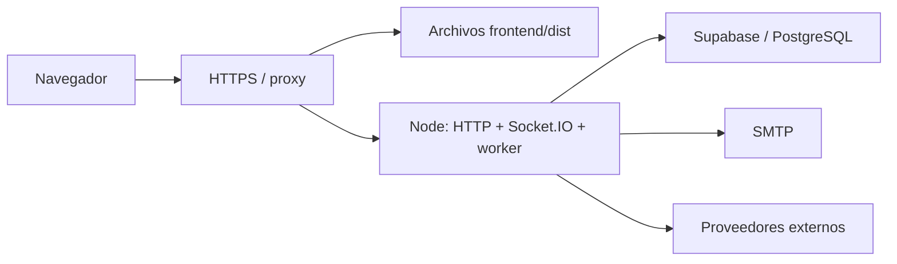

# 🚀 Instalación y operación

[Índice](README.md) · [Migraciones](MIGRACIONES.md) · [Mantenimiento](MANTENIMIENTO.md)

## Requisitos

Se necesitan Node.js y npm compatibles con las dependencias fijadas en ambos lockfiles, un proyecto Supabase/PostgreSQL, servicio SMTP y un cliente Google configurado. Los paquetes no declaran una versión unificada mediante `engines`; seleccionar una versión de Node compatible con Vite 8 y con el backend, y fijarla en el entorno de despliegue.

Cada aplicación tiene su propio `package.json` y `package-lock.json`. Los comandos siguientes parten de la raíz del repositorio. Son instrucciones operativas; no se ejecutaron durante esta actualización documental.

```powershell
npm ci --prefix backend
npm ci --prefix frontend
```

## Variables del backend

Crear `backend/.env` en el entorno local o inyectar las variables desde el alojamiento. La validación de [env.ts](../backend/src/config/env.ts) detiene el arranque si faltan valores requeridos. No incorporar el archivo con credenciales al repositorio.

| Variable | Obligatoria / valor predeterminado | Uso |
| --- | --- | --- |
| `NODE_ENV` | `development` | `development`, `test` o `production` |
| `PORT` | `3000` | Puerto HTTP |
| `FRONTEND_URL` | `http://localhost:5173` | URL del cliente utilizada por el servidor |
| `SUPABASE_URL` | Sí | Proyecto de datos |
| `SUPABASE_PUBLISHABLE_KEY` | Sí | Clave pública de Supabase requerida por configuración |
| `SUPABASE_SECRET_KEY` | Sí | Acceso privilegiado del servidor |
| `SUPABASE_JWKS_URL` | Opcional | URL JWKS configurada |
| `JWT_ACCESS_SECRET` | Sí, mínimo 12 caracteres | Firma del JWT propio; usar un secreto robusto |
| `JWT_ACCESS_EXPIRES_MINUTES` | `10` | Duración del acceso, en minutos |
| `REFRESH_TOKEN_EXPIRES_DAYS` | `7` | Duración de renovación |
| `LOGIN_MAX_ATTEMPTS` | `5` | Umbral de intentos fallidos |
| `LOGIN_LOCK_MINUTES` | `15` | Bloqueo temporal |
| `PASSWORD_RECOVERY_MINUTES` | `15` | Vigencia de recuperación |
| `EMAIL_VERIFICATION_HOURS` | `24` | Vigencia de verificación |
| `GOOGLE_CLIENT_ID` | Sí | Audiencia de identidad Google |
| `MAIL_HOST`, `MAIL_PORT` | Sí | Servidor y puerto SMTP |
| `MAIL_SECURE` | Sí | Solo el texto `true` se transforma en verdadero |
| `MAIL_USER`, `MAIL_PASSWORD` | Sí | Credenciales SMTP; usuario con formato de email |
| `MAIL_FROM_NAME`, `MAIL_FROM_EMAIL` | Sí | Remitente |
| `CHATBOT_ENABLED` | Deshabilitado si no es `true` | Activar prototipo optativo |
| `GEMINI_API_KEY` | Opcional | Credencial del proveedor del asistente |
| `GEMINI_MODEL` | `gemini-3.5-flash-lite` | Valor predeterminado del código; disponibilidad depende del proveedor |

## Variables del frontend

| Variable | Uso |
| --- | --- |
| `VITE_API_URL` | URL pública de la API, normalmente terminada en `/api`; fallback local `http://localhost:3000/api` |
| `VITE_GOOGLE_CLIENT_ID` | Cliente de Google para el flujo del navegador |

Vite incorpora estas variables en la compilación. Cambiar las variables del servidor estático después del build no modifica un bundle ya generado. No colocar secretos en variables `VITE_*`.

## Preparar la base

Seguir [migraciones](MIGRACIONES.md). El SQL base elimina datos y solo corresponde a un reinicio expresamente previsto. Para una base existente, identificar primero qué migraciones están aplicadas y ejecutar únicamente las pendientes compatibles, con respaldo y recuperación preparados.

El repositorio no incluye evidencia del estado de una base desplegada. Los triggers y RPC de agenda requieren la secuencia completa de migraciones, no únicamente el archivo más reciente.

## Desarrollo local

Abrir dos terminales desde la raíz:

```powershell
npm run dev --prefix backend
```

```powershell
npm run dev --prefix frontend
```

Por defecto la API escucha en el puerto 3000 y Vite en 5173. La disponibilidad de otro puerto puede depender de la configuración efectiva. Revisar el endpoint de salud HTTP y, por separado, el de base de datos según las [rutas declaradas](API_RUTAS.md).

## Compilación y alojamiento

```powershell
npm run build --prefix backend
npm run build --prefix frontend
npm start --prefix backend
```

El backend ejecuta `dist/server.js`; publicar el frontend desde `frontend/dist`. Configurar fallback SPA a `index.html` para rutas del navegador, HTTPS, URL de API y proxy compatible con Socket.IO. `vite preview` es una herramienta de revisión local, no una configuración de producción.



El worker vive dentro del proceso del backend. Un alojamiento que suspende el proceso también detiene sus revisiones periódicas. Las funciones SQL coordinan reclamaciones y leases; no asumir que escalar instancias duplica de forma segura cualquier tarea ajena a esos mecanismos.

## Utilidades y diagnóstico

`npm run seed:superadmin --prefix backend` modifica cuentas en la base configurada. `npm run check:email --prefix backend` puede enviar correo. Leer los [scripts](../backend/src/scripts) y confirmar el entorno antes de ejecutarlos.

Ante un fallo de arranque, revisar nombres y tipos de variables; ante errores RPC o columnas faltantes, revisar migraciones; ante 401/403, revisar sesión, rol, perfil y asignación. Si la reserva fue confirmada pero no llegó el aviso, inspeccionar comunicaciones sin duplicar la reserva.

El apagado gestionado atiende SIGTERM/SIGINT y espera tareas del procesador. Configurar en el alojamiento un tiempo suficiente de terminación y registrar incidentes sin volcar tokens ni información personal innecesaria.
