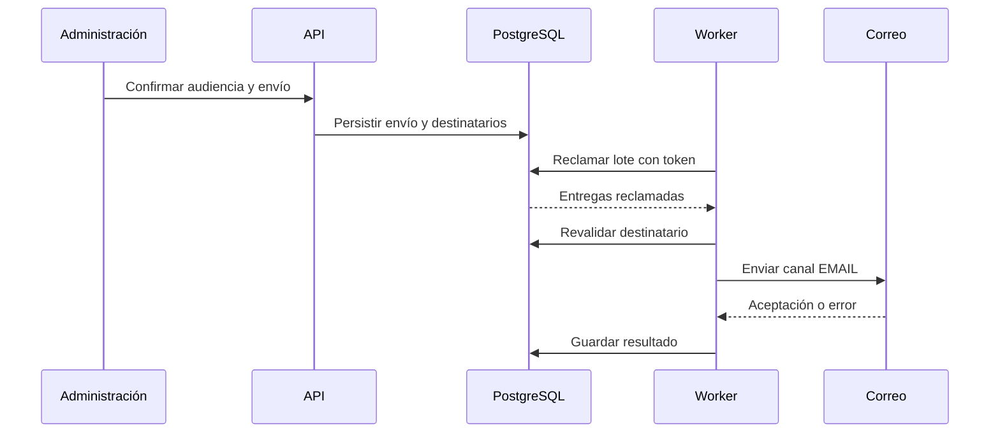

# 🔌 Integraciones y procesos periódicos

[Índice](README.md) · [Notificaciones](NOTIFICACIONES.md) · [Calendario](argentinadatos-calendario.md)

| Integración | Finalidad | Comportamiento ante independencia o fallo |
| --- | --- | --- |
| Supabase/PostgreSQL | Persistencia, consultas y RPC | Es dependencia central de las operaciones |
| SMTP / Nodemailer | Verificación, recuperación y comunicaciones | Aceptación SMTP no demuestra entrega ni lectura |
| Google Identity Services | Identidad externa del paciente | Backend verifica audiencia del token |
| ArgentinaDatos | Importar feriados anuales | La reserva consulta cierres locales, sin llamar al proveedor |
| RSS municipal | Noticias externas públicas | Caché y tratamiento de fallos en el servicio |
| Gemini | Orientación funcional optativa | No es requisito de arranque ni acceso a datos de pacientes |
| Socket.IO | Señal de cambio de agenda | Cliente vuelve a consultar datos autorizados |

## Worker de comunicaciones

El servidor inicia un procesador periódico que reclama tareas persistidas mediante SQL. Trabaja en lotes de hasta 50 y revisa periódicamente con intervalo de 15 segundos cuando está ocioso. La selección de audiencia se confirma, se congela y vuelve a validarse antes de entregar; el remitente queda excluido.

Las tareas de canal SISTEMA pueden recuperarse después del plazo de abandono de diez minutos. Un EMAIL interrumpido no se reintenta automáticamente de la misma manera, para evitar duplicación incierta. No se promete entrega exactamente una vez. Consultar [notificaciones](NOTIFICACIONES.md) para estados, edición y cancelación.

## Calendario institucional

La revisión automática apunta al sábado a las 03:00 de Argentina y se ejecuta en el siguiente ciclo del worker. Tras una interrupción puede recuperar una ejecución vencida. El lease dura cinco minutos; cada año se importa en su propia transacción. Se consideran año actual y siguiente.

El proveedor tiene timeout de ocho segundos y límite de 250 KB, hasta 366 registros y validación estricta. No se elimina un cierre solo porque desaparezca de una respuesta posterior ni se deduce automáticamente un traslado. Tras un fallo, la siguiente oportunidad es la ejecución programada o una solicitud manual autorizada. Detalles en [ArgentinaDatos](argentinadatos-calendario.md).

## Contenido externo

El RSS municipal usa un origen fijo de Goya; consulta metadatos de hasta seis noticias, con timeout de ocho segundos y límite de 1 MB. Rechaza redirecciones y construcciones XML peligrosas. La caché contempla 30 minutos de éxito, cinco de fallo y hasta 24 horas de datos anteriores. No se verificó disponibilidad externa durante esta revisión.

Las noticias internas son otro módulo: texto e imagen por URL HTTPS, sin carga de archivos. Véase [contenido público](CONTENIDO_PUBLICO.md).

## Tiempo real y asistente

Socket.IO valida credenciales y vincula automáticamente la conexión profesional a `profesional:${id}`. El evento `agenda:cambio` también puede emitirse hacia `salita:${id}`, pero esa emisión no demuestra que todos los roles ingresen automáticamente a salas territoriales. No prometer cobertura de tiempo real universal.

El chatbot está deshabilitado por defecto. Utiliza preguntas funcionales canónicas y no entrega acceso a herramientas de escritura ni a datos clínicos. Los límites por proceso y el tratamiento de entradas están descritos en [CHATBOT.md](CHATBOT.md).
