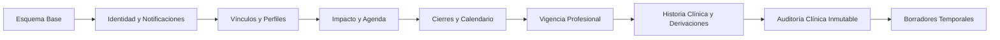

# 🧱 Migraciones de PostgreSQL

[← Volver al Índice](README.md) · [Modelo de datos](BASE_DE_DATOS.md) · [Diccionario SQL](DICCIONARIO_SQL.md) · [Instalación](INSTALACION_Y_OPERACION.md)

## Base y actualización incremental

[SAPS_Turno_BBDD3_FINAL.sql](../backend/src/BBDD/SAPS_Turno_BBDD3_FINAL.sql) es un script de reinicio completo para entornos de desarrollo: ejecuta `DROP TABLE ... CASCADE` y elimina datos antes de recrear los esquemas. **No debe utilizarse en entornos con datos productivos que se deban conservar.**

Las migraciones incrementales están ubicadas en [backend/src/BBDD](../backend/src/BBDD). El orden siguiente conserva las dependencias explícitas de tablas, tipos, columnas y funciones; dentro de una misma fecha el nombre alfabético no determina necesariamente el orden correcto de aplicación.

| Paso | Archivo | Evolución y propósito |
| --- | --- | --- |
| 1 | `20260926_email_verification_attempts.sql` | Intentos y límites de verificación de correo |
| 2 | `20260929_password_recovery_codes.sql` | Recuperación de contraseñas mediante códigos OTP |
| 3 | `20260929_patient_email_change.sql` | Cambio seguro de correo electrónico del paciente |
| 4 | `20261006_unique_person_email.sql` | Unicidad del correo a nivel de persona física |
| 5 | `20261006_notificaciones_audiencia.sql` | Selección y filtrado de destinatarios |
| 6 | `20261006_notificaciones_envios.sql` | Envíos y registros de entrega de avisos |
| 7 | `20261006_notificaciones_worker.sql` | Reclamación transaccional y procesamiento por worker |
| 8 | `20261006_notificaciones_edicion.sql` | Edición y cancelación de envíos pendientes |
| 9 | `20261006_notificaciones_excluir_remitente.sql` | Exclusión del remitente en avisos masivos |
| 10 | `20261007_contenido_publico.sql` | Categorías y publicaciones de noticias públicas |
| 11 | `20261011_admin_profile.sql` | Perfil y datos complementarios de administradores |
| 12 | `20261020_sancion_global_inasistencia.sql` | Sanción por inasistencia reiterada para todas las especialidades |
| 13 | `20261031_solicitudes_vinculacion.sql` | Solicitudes, aprobación e historial de vínculos tutor/paciente |
| 14 | `20261103_agenda_impacto.sql` | Análisis de impacto y serialización de agenda |
| 15 | `20261103_agenda_escritura.sql` | Escritura transaccional de reubicaciones e historial |
| 16 | `20261107_cierres_calendario.sql` | Cierres institucionales, asuetos y bloqueos masivos |
| 17 | `20261108_argentinadatos.sql` | Sincronización con ArgentinaDatos, lease y feriados nacionales |
| 18 | `20261109_profesional_salita_vigencia.sql` | Validación estricta de asociación profesional-salita vigente |
| 19 | `20261110_historia_clinica.sql` | Modelo clínico longitudinal, expedientes, consultas, diagnósticos, evoluciones con rectificación, tratamientos, estudios, derivaciones inter-salitas y auditoría clínica inmutable |
| 20 | `20261110_super_admin_auditoria_clinica.sql` | Habilita el permiso `VER_AUDITORIA_CLINICA` al rol `SUPER_ADMIN` |
| 21 | `20261115_admin_recepcion_ver_historia_clinica.sql` | Asigna `VER_HISTORIA_CLINICA` a `ADMIN_SALITA` y `RECEPCION` con alcance acotado a su salita asignada |
| 22 | `20261115_fix_auditoria_clinica_columns.sql` | Ajuste de nombres de columnas y triggers en auditoría clínica |
| 23 | `PROPUESTA_20261110_hc_borradores_y_turno_anticipado.sql` | Propuesta aditiva para autoguardado de borradores temporales con concurrencia optimista y preparación de consulta anticipada |

---

## Procedimiento operativo de aplicación

1. **Revisión previa**: Identificar el entorno de base de datos, el commit actual y las migraciones previamente aplicadas.
2. **Inspección de precondiciones**: Leer el script completo y verificar las dependencias de tablas, índices y funciones.
3. **Respaldo previo**: Efectuar copia de seguridad (`pg_dump` o snapshot en Supabase) antes de aplicar migraciones que modifiquen funciones nucleares.
4. **Ejecución secuencial**: Aplicar las migraciones estrictamente en el orden numérico indicado.
5. **Verificación de objetos**: Confirmar que los triggers (`tr_auditoria_clinica_inmutable`, `tr_turnos_validar_cierre`, etc.) y las funciones RPC queden en estado válido.

---

## Cambios de funciones, triggers y política de rollback

- Las funciones modificadas mediante `CREATE OR REPLACE FUNCTION` actualizan la lógica en caliente sin requerir reinicio de la base de datos.
- Las restricciones de inmutabilidad en la tabla `auditoria_clinica` y `auditoria_accesos_auditoria` impiden sentencias `UPDATE` y `DELETE` accidentales o intencionadas.
- No se admiten eliminaciones físicas en tablas asistenciales; se emplean estados lógicos (`ANULADO`, `RECTIFICADA`, `INACTIVA`).
- Cualquier reversión debe realizarse mediante migraciones compensatorias documentadas o restauración del respaldo de base de datos previo.
