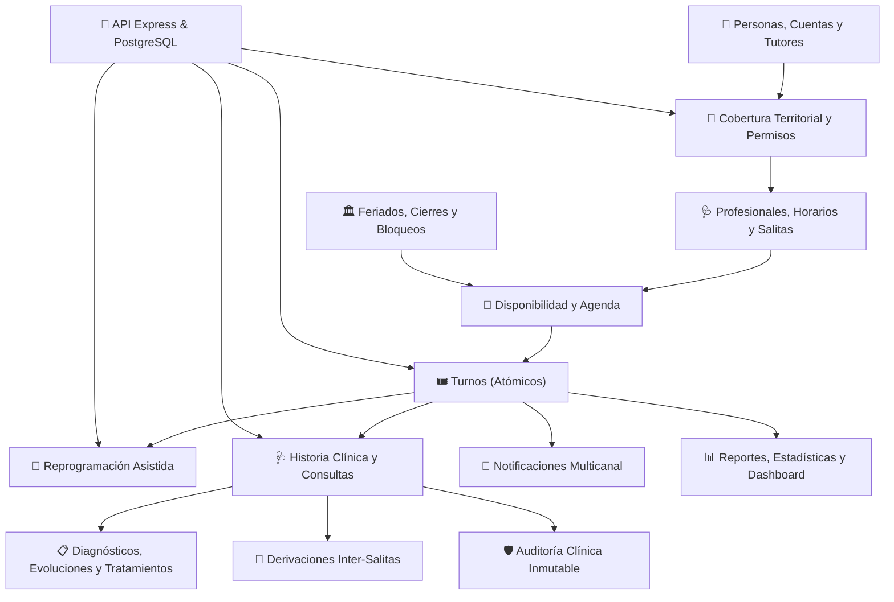

# 📚 Documentación de CORA · SAPS Turno

[← Volver a la presentación del proyecto](../README.md)

Esta biblioteca documenta exhaustivamente la implementación completa disponible en el repositorio de **CORA · SAPS Turno**: aplicación cliente React 19, API REST modular con Express 5, base de datos relacional PostgreSQL sobre Supabase, procesos periódicos en segundo plano, historia clínica electrónica e integraciones.

---

## 🧭 Recorridos de lectura sugeridos

| Necesidad | Recorrido recomendado |
| --- | --- |
| **Entender el producto y funciones** | [Manual por rol](MANUAL_USUARIO.md) → [Reglas de turnos](TURNOS_Y_DISPONIBILIDAD.md) → [Historia clínica](HISTORIA_CLINICA.md) |
| **Explorar diagramas e ingeniería** | [Diagramas del sistema (Casos de uso, Secuencia y ER)](DIAGRAMAS.md) → [Arquitectura](ARQUITECTURA.md) |
| **Incorporarse al desarrollo** | [Arquitectura](ARQUITECTURA.md) → [Backend](BACKEND.md) → [Frontend](FRONTEND.md) → [Inventario de código](INVENTARIO_CODIGO.md) |
| **Preparar y desplegar un entorno** | [Instalación y operación](INSTALACION_Y_OPERACION.md) → [Migraciones de PostgreSQL](MIGRACIONES.md) |
| **Integrar o auditar la API** | [Contrato HTTP](API.md) → [Inventario completo de rutas](API_RUTAS.md) → [Seguridad y permisos](SEGURIDAD_Y_ACCESO.md) |
| **Comprender datos y persistencia** | [Modelo de datos](BASE_DE_DATOS.md) → [Diccionario SQL](DICCIONARIO_SQL.md) → [Historia clínica](HISTORIA_CLINICA.md) |
| **Mantenimiento y soporte** | [Mantenimiento y operaciones](MANTENIMIENTO.md) → Documentación del módulo específico |

---

## 🗂️ Catálogo por área

| Área | Documentos |
| --- | --- |
| 📊 **Diagramas y diseño** | [Diagramas completos (Casos de uso, Secuencia, ER)](DIAGRAMAS.md) |
| 🏗️ **Arquitectura y código** | [Arquitectura](ARQUITECTURA.md), [Backend](BACKEND.md), [Frontend](FRONTEND.md), [Inventario de código](INVENTARIO_CODIGO.md) |
| 🩺 **Salud e Historia Clínica** | [Historia clínica electrónica](HISTORIA_CLINICA.md) |
| 🗄️ **Datos y contratos** | [Base de datos](BASE_DE_DATOS.md), [Diccionario SQL](DICCIONARIO_SQL.md), [Migraciones](MIGRACIONES.md), [API general](API.md), [Rutas de la API](API_RUTAS.md) |
| 🔐 **Identidad y protección** | [Autenticación](AUTENTICACION.md), [Seguridad y acceso](SEGURIDAD_Y_ACCESO.md), [Privacidad del navegador](PRIVACIDAD_NAVEGADOR.md) |
| 👥 **Pacientes y comunidad** | [Autogestión de pacientes](PACIENTE_AUTOGESTION.md), [Personas a cargo y tutores](personas-a-cargo.md), [Manual por rol](MANUAL_USUARIO.md) |
| 🏥 **Recursos territoriales** | [Salitas, barrios, zonas, profesionales y configuración](RECURSOS_Y_CONFIGURACION.md) |
| 📅 **Turnos y agenda** | [Reservas y disponibilidad](TURNOS_Y_DISPONIBILIDAD.md), [Vigencia profesional-salita](VIGENCIA_PROFESIONAL_SALITA.md), [Concurrencia de agenda](CONCURRENCIA_AGENDA.md) |
| 🔄 **Reprogramación asistida** | [Asistencia de agenda](agenda-reprogramacion-asistida.md), [Ausencias y reprogramación rápida](ausencias-reprogramacion-rapida.md) |
| 🏛️ **Calendario institucional** | [Feriados y cierres](feriados-cierres-institucionales.md), [Sincronización con ArgentinaDatos](argentinadatos-calendario.md) |
| 📢 **Comunicaciones y contenidos**| [Notificaciones](NOTIFICACIONES.md), [Contenido público y noticias](CONTENIDO_PUBLICO.md), [Integraciones y WebSockets](INTEGRACIONES.md) |
| 📈 **Información de gestión** | [Reportes y auditoría general](REPORTES_Y_AUDITORIA.md), [Dashboard de administración](DASHBOARD_SUPER_ADMIN.md) |
| 💬 **Asistente virtual** | [Asistente CORA](CHATBOT.md), [Verificación del asistente](CHATBOT_VERIFICACION.md) |
| ⚙️ **Operación e infraestructura** | [Instalación y operación](INSTALACION_Y_OPERACION.md), [Mantenimiento preventivo](MANTENIMIENTO.md) |

---

## 🧩 Mapa del sistema

---

## 📌 Convenciones de la documentación

- **Diagramas Mermaid**: Representan relaciones arquitectónicas, de datos o secuencias de llamadas vigentes en el código.
- **Enlaces a código fuente**: Son relativos a la raíz del repositorio (`../backend/...`, `../frontend/...`).
- **Garantía relacional**: Las restricciones de integridad y exclusiones se validan en el motor PostgreSQL (`EXCLUDE USING gist`, `CHECK`, foreign keys y triggers).
- **Inmutabilidad clínica**: Los registros médicos firmados y los eventos de auditoría clínica rechazan modificaciones y borrados a nivel de disparadores SQL.

---

## 📖 Glosario de términos del sistema

| Término | Definición |
| --- | --- |
| **Persona** | Identidad civil y datos personales básicos; puede tener múltiples perfiles (paciente, profesional, tutor). |
| **Usuario** | Cuenta que autentica en el sistema mediante credenciales (email/contraseña o Google Auth). |
| **Paciente** | Sujeto de atención en la red primaria de salud. Puede existir sin una cuenta de usuario propia. |
| **Tutor / Responsable** | Persona vinculada legalmente a un paciente mediante una autorización aprobada formalmente. |
| **Salita** | Centro de Atención Primaria de la Salud (SAPS) municipal de Goya, Corrientes. |
| **Historia Clínica (HCE)** | Expediente médico longitudinal único por paciente, consolidado en toda la red de salitas. |
| **Consulta Médica** | Acto asistencial realizado por un profesional en una salita, originado por turno o atención espontánea. |
| **Evolución Rectificada** | Actualización médica sobre un acto ya firmado; preserva la nota original y referencia su corrección. |
| **Derivación Clínica** | Autorización formal para que un paciente sea atendido y su historial consultado en otra salita por otra especialidad. |
| **Vigencia** | Intervalo de validez temporal y estado habilitado de una asignación profesional-salita o credencial. |
| **Slot** | Franja horaria de atención calculada dinámicamente; no es un registro persistido hasta su reserva formal. |
| **Turno Afectado** | Turno previamente reservado que colisiona con un cierre institucional, asueto o ausencia médica. |
| **Reprogramación Asistida**| Algoritmo que detecta turnos afectados y calcula franjas alternativas óptimas para su reubicación. |
| **Lease** | Concesión temporal con token exclusivo para sincronizaciones periódicas (ej. feriados de ArgentinaDatos). |
