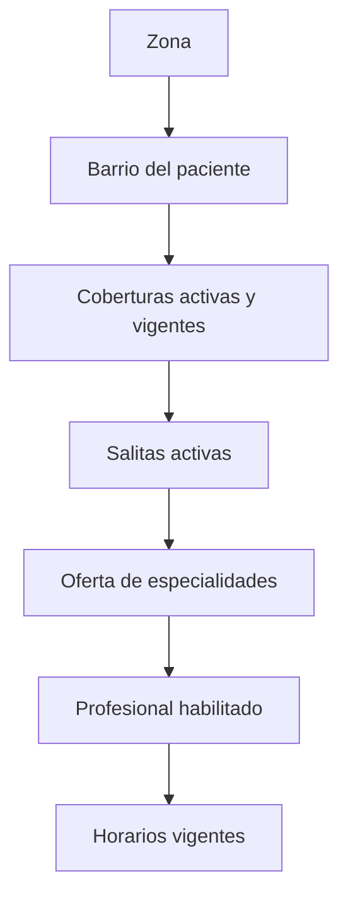

# 🏥 Recursos, cobertura y configuración

[Índice](README.md) · [Vigencia profesional](VIGENCIA_PROFESIONAL_SALITA.md)

## Modelo territorial

Las zonas agrupan barrios. `salita_barrios` define cobertura y fechas; `usuario_salita` define el alcance administrativo. La cobertura del paciente y el permiso del operador son relaciones diferentes.

El servicio de cobertura verifica barrio, relación territorial y salita. Conserva una asignación actual que siga siendo válida; puede resolver una única opción disponible. Cuando hay varias opciones válidas, no selecciona arbitrariamente una de ellas.

## Profesionales y oferta

El perfil profesional contiene identidad y matrícula. Sus asociaciones con especialidades y salitas definen habilitación; los horarios agregan franjas, fechas y duración. Crear una cuenta profesional no equivale a crear toda la oferta de atención.

La oferta por salita se configura mediante `salita.especialidades`. Una actualización con valor nulo conserva la oferta previa; una lista explícita restringe las especialidades y una lista vacía deja la oferta sin especialidades. Consultar el validador antes de construir un formulario o integración.

La baja lógica retira recursos de operaciones futuras según las reglas de cada módulo, conservando referencias históricas. Antes de modificar horarios o asociaciones, revisar el impacto de agenda.

## Configuración global y local

`configuracion` conserva parámetros con alcance global o por salita. Los servicios aplican una política de claves autorizadas y tipos; los valores públicos tienen una lista permitida explícita. No tratar esta tabla como un almacén público de secretos.

Entre las claves locales permitidas figuran `agenda.intervalo_default`, `notificaciones.recordatorio_horas`, `turnos.dias_anticipacion`, `turnos.cancelacion_horas` y `sanciones.duracion_dias`. La existencia de una clave no demuestra que cada regla funcional la consuma. La ventana semanal del paciente y la sanción global de siete días tienen comportamiento específico en código.

## Secuencia de preparación

1. Registrar territorio y salitas.
2. Definir coberturas con fechas consistentes.
3. Configurar oferta de especialidades.
4. Registrar profesionales y asociaciones vigentes.
5. Crear horarios y verificar su impacto.
6. Asignar cuentas administrativas a las salitas correspondientes.
7. Revisar cierres institucionales y consultar disponibilidad antes de habilitar la operación.

Fuentes: [servicios de recursos](../backend/src/services), [repositorios](../backend/src/repositories), [validadores](../backend/src/validators), [rutas](API_RUTAS.md). El inventario permite localizar los archivos de cobertura, configuración y asociaciones por nombre.
