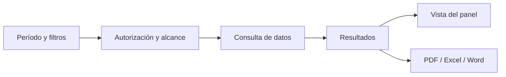

# 📊 Reportes, dashboard y auditoría

[Índice](README.md) · [Dashboard detallado](DASHBOARD_SUPER_ADMIN.md)

## Consultas disponibles

| Consulta | Acceso declarado en rutas | Resultado |
| --- | --- | --- |
| Dashboard | SUPER_ADMIN | Indicadores generales y actividad reciente |
| Resumen, especialidades, profesionales | SUPER_ADMIN, ADMIN_SALITA, RECEPCION | Estadísticas del período y alcance autorizado |
| Agenda diaria | SUPER_ADMIN, ADMIN_SALITA, PROFESIONAL | Agenda nominal; profesional limitado a su identidad |
| Exportación estadística | Roles de estadísticas | PDF, Excel o Word |
| Exportación e impresión de agenda | Roles de agenda diaria | Salida de agenda con contexto de consulta |

El alcance se aplica en el servidor además del filtro visual. Una asociación profesional-salita vencida hoy no debe borrar de los reportes la atención histórica realizada allí.

## Interpretación de indicadores

El dashboard cuenta entidades activas; no confundir el número de profesionales con el número de sus asignaciones. Los turnos registrados hoy usan `fecha_solicitud`; los programados para hoy usan `fecha_hora_inicio`. Son preguntas distintas.

Los indicadores se obtienen mediante consultas independientes, por lo que no representan necesariamente una única fotografía transaccional. La actividad reciente muestra hasta ocho registros de auditoría saneados para el panel. Para detalle, consultar el módulo correspondiente.

## Exportaciones

Las salidas incluyen contexto de período y alcance para evitar interpretar un archivo filtrado como un total global. PDFKit, ExcelJS y docx producen los formatos correspondientes. Descargar un reporte genera una copia fuera de la aplicación; su tratamiento debe respetar las prácticas institucionales sobre datos personales.

## Historial y auditoría

`historial_turnos` registra la evolución del turno; `auditoria` registra operaciones del sistema. Las RPC de agenda agrupan las escrituras correspondientes dentro de su transacción. El correo y la señal Socket.IO ocurren después y pueden tener un resultado diferente de la operación principal.

Para investigar una incidencia, conservar identificador del recurso, actor, fecha con zona horaria y operación; consultar historial y auditoría antes de corregir datos. No inferir fracaso de una reserva únicamente porque faltó el aviso por correo.

Fuentes: [rutas de reportes](../backend/src/routes/reporte.routes.ts), [servicios](../backend/src/services), [repositorios](../backend/src/repositories), [utilidades de exportación](../backend/src/utils).
