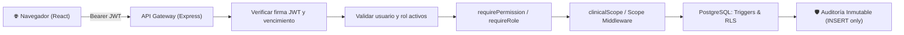

# 🔐 Seguridad, Permisos y Autorización

[← Volver al Índice](README.md) · [Autenticación](AUTENTICACION.md) · [Historia Clínica](HISTORIA_CLINICA.md) · [Diagramas](DIAGRAMAS.md) · [Privacidad](PRIVACIDAD_NAVEGADOR.md)

## Límites de confianza y arquitectura de seguridad

Los controles en la interfaz de usuario (React) facilitan la experiencia de navegación, pero **no conceden privilegios**. Toda autorización se evalúa de manera estricta y determinista en el backend antes de resolver cualquier operación sobre la base de datos.

---

## Modelo de autorización híbrido (Roles + Permisos + Alcance Clínico)

El sistema combina tres capas complementarias de autorización:
1. **Roles del Sistema (`requireRole`)**: Valida el rol estructural (`SUPER_ADMIN`, `ADMIN_SALITA`, `PROFESIONAL`, `PACIENTE`, `RECEPCION`).
2. **Permisos Asignados (`requirePermission`)**: Verifica que el rol del usuario contenga el código del permiso en la tabla `rol_permisos`.
3. **Alcance Contextual (`clinicalScope` / `clinicalResourceScope` / `clinicalDerivationScope`)**: Verifica la relación física o jurídica entre el usuario y el recurso:
   - Para un `PROFESIONAL`: requiere asignación vigente a la salita del paciente o existencia de una **derivación clínica autorizada**.
   - Para un `ADMIN_SALITA` / `RECEPCION`: restringe la lectura exclusivamente a pacientes radicados en su propia salita.
   - Para un `PACIENTE`: restringe el acceso exclusivamente a su propio registro (`id_paciente`) o a tutelados con vínculo formalmente aprobado.

---

## Matriz de Roles y Permisos Clínicos

| Permiso | Código | SUPER_ADMIN | ADMIN_SALITA | RECEPCION | PROFESIONAL | PACIENTE |
| --- | --- | :---: | :---: | :---: | :---: | :---: |
| **Ver historia clínica** | `VER_HISTORIA_CLINICA` | ❌ (1) | ✅ (Salita) | ✅ (Salita) | ✅ (Vigente / Derivación) | ✅ (Propia) |
| **Crear consulta médica** | `CREAR_CONSULTA_CLINICA` | ❌ | ❌ | ❌ | ✅ | ❌ |
| **Gestionar antecedentes** | `GESTIONAR_ANTECEDENTES_CLINICOS` | ❌ | ❌ | ❌ | ✅ | ❌ |
| **Registrar diagnósticos** | `REGISTRAR_DIAGNOSTICOS` | ❌ | ❌ | ❌ | ✅ | ❌ |
| **Registrar evoluciones** | `REGISTRAR_EVOLUCIONES` | ❌ | ❌ | ❌ | ✅ | ❌ |
| **Gestionar tratamientos** | `GESTIONAR_TRATAMIENTOS` | ❌ | ❌ | ❌ | ✅ | ❌ |
| **Gestionar estudios** | `GESTIONAR_ESTUDIOS_CLINICOS` | ❌ | ❌ | ❌ | ✅ | ❌ |
| **Gestionar derivaciones** | `GESTIONAR_DERIVACIONES_CLINICAS`| ❌ | ❌ | ❌ | ✅ | ❌ |
| **Ver auditoría clínica** | `VER_AUDITORIA_CLINICA` | ✅ | ❌ | ❌ | ❌ | ❌ |

*(1) Por principio de separación de funciones y confidencialidad médica, el rol administrativo global `SUPER_ADMIN` no cuenta con lectura directa de historias clínicas de pacientes, pero sí audita todos los accesos mediante `VER_AUDITORIA_CLINICA`.*

---

## Protección de datos sensibles e inmutabilidad

1. **Cabecera Anti-Caché**: En todas las rutas de historia clínica (`/api/historia-clinica/*`) se inyecta la cabecera `Cache-Control: no-store` para impedir que proxies, navegadores o memorias intermedias retengan datos de salud.
2. **Inmutabilidad en Motor SQL**:
   - Disparador `tr_auditoria_clinica_inmutable`: Dispara excepción inmediata ante sentencias `UPDATE` o `DELETE` sobre la tabla `auditoria_clinica`.
   - Disparador `tr_auditoria_acc_aud_inmutable`: Protege la tabla de auditoría de accesos a la propia auditoría.
3. **Criptografía y Credenciales**:
   - Contraseñas almacenadas mediante hash seguro con **Argon2id**.
   - Tokens de acceso (JWT) firmados con **JOSE / HS256** con tiempo de vida corto (15 minutos).
   - Refresh tokens almacenados con hash criptográfico en `sesiones_refresh` con revocación dinámica y rotación obligatoria.
4. **Protección de Navegación**:
   - Cabeceras de seguridad aplicadas mediante **Helmet**.
   - Validación estricta de esquemas de entrada para prevenir inyecciones y desbordes de datos.
