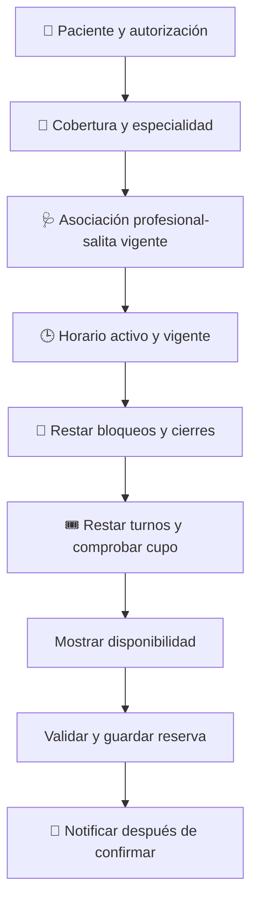

# 🎟️ Turnos y disponibilidad

[Índice](README.md) · [Concurrencia](CONCURRENCIA_AGENDA.md) · [Autogestión](PACIENTE_AUTOGESTION.md)

## De la configuración a una reserva

Un horario define una franja semanal, duración de consulta, vigencia y cupo diario opcional. La disponibilidad calcula bloques para una fecha; esos bloques no quedan reservados al mostrarse. La escritura vuelve a validar las condiciones y puede rechazar un bloque que otro usuario acaba de ocupar.

## Reglas temporales

- La agenda utiliza `America/Argentina/Buenos_Aires`; una fecha local no debe obtenerse cortando un timestamp UTC.
- Los turnos usan instantes con zona horaria. Las vigencias y cierres usan fechas de calendario; las franjas de horarios y bloqueos usan horas locales.
- Los extremos de vigencia son inclusivos. Un fin nulo representa continuidad.
- Los intervalos de ocupación son `[inicio, fin)`: dos consultas consecutivas pueden compartir el límite sin superponerse.
- El horario debe coincidir con profesional, especialidad, salita, día ISO de semana y duración. El inicio debe alinearse con un bloque de la franja.
- El cupo máximo diario limita la cantidad de turnos que ocupan agenda para ese horario y fecha; no expresa atención simultánea.

En autogestión, la ventana parte del día actual y llega al domingo; desde el sábado a las 12:00 de Argentina incorpora la semana siguiente. No habilita fechas pasadas. La configuración genérica no reemplaza automáticamente esta regla implementada.

## Estados y ocupación

| Estado inicial del catálogo | Ocupa agenda | Interpretación |
| --- | --- | --- |
| SOLICITADO | Sí | Reserva solicitada |
| CONFIRMADO | Sí | Reserva confirmada |
| EN_ESPERA | Sí | Paciente en espera |
| ATENDIDO | No | Atención finalizada |
| NO_ASISTIO | No | Inasistencia registrada |
| CANCELADO | No | Reserva cancelada |
| REPROGRAMADO | No | Estado final disponible en catálogo |

La reprogramación implementada modifica el mismo turno y conserva un estado activo; no debe interpretarse como un cambio automático al estado `REPROGRAMADO`. Las transiciones autorizadas dependen del servicio y del actor. El historial permite reconstruir modificaciones.

PostgreSQL impide superposiciones del profesional y del paciente cuando el turno ocupa agenda. También aplica la restricción de reserva por paciente/especialidad según el indicador de estado correspondiente. Las sanciones y los límites pertenecen al paciente atendido, incluso cuando reserva un responsable.

## Ausencias, cancelación y reprogramación

`NO_ASISTIO` produce una sanción global de siete días (168 horas), para todas las especialidades. No cancela automáticamente reservas existentes. Los permisos y plazos de cancelación se verifican antes de guardar.

Un cambio de horario, bloqueo o cierre manual debe identificar los turnos afectados y resolverlos. La propuesta de reemplazos es orientativa: cada confirmación vuelve a validar disponibilidad y versión. Un lote puede finalizar parcialmente; no constituye una transacción única que revierta todas las operaciones.

Los cierres importados del calendario tienen un tratamiento específico: pueden coexistir con reservas previas y dejar su resolución pendiente. Consultar [calendario institucional](feriados-cierres-institucionales.md).

## Responsabilidades y fuentes

Los servicios de turnos y disponibilidad coordinan reglas del usuario; los repositorios consultan datos y RPC; los triggers conservan las restricciones finales. El historial y los reportes no deben ocultar turnos antiguos por la vigencia actual de una asociación.

Fuentes: [servicios](../backend/src/services), [repositorios](../backend/src/repositories), [utilidades de agenda](../backend/src/utils), [DDL y migraciones](../backend/src/BBDD), [componentes de turnos](../frontend/src/components/turnos).
