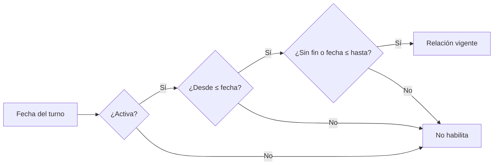

# 🩺 Vigencia de asociaciones profesional-salita

[Índice](README.md) · [Modelo de datos](BASE_DE_DATOS.md)

## Regla única

Una asociación habilita atención en la fecha consultada cuando `activo = true`, `fecha_desde <= fecha` y `fecha_hasta IS NULL OR fecha_hasta >= fecha`. La fecha pertenece a la zona argentina. La existencia de la fila o su indicador activo por sí solos no bastan.

## Aplicación por operación

| Operación | Fecha y comportamiento |
| --- | --- |
| Disponibilidad | Día solicitado; sin asociación válida devuelve ausencia de oferta |
| Consulta de horarios por fecha | Intersecta vigencia de asociación y del horario |
| Reserva manual o con horario | Día local del turno; validación final en PostgreSQL |
| Habilitación administrativa de cuenta | Día actual en Argentina |
| Historial y reportes | Conservan relaciones históricas; no filtran por vigencia de hoy |
| Consulta del repositorio sin fecha | Puede recuperar asociaciones históricas para administración |

`profesional_salita` tiene una clave por profesional y salita. No modela múltiples períodos discontinuos como filas independientes para el mismo par. Tampoco tiene un campo `es_principal`.

## Garantía en la escritura

La migración [20261109_profesional_salita_vigencia.sql](../backend/src/BBDD/20261109_profesional_salita_vigencia.sql) reemplaza `validar_turno()` sin recrear tablas ni triggers. Para un turno que ocupa agenda, busca la asociación vigente y toma `FOR SHARE`, retenido hasta terminar la transacción. Después valida el horario o la habilitación de especialidad del turno manual, y los bloqueos.

Los turnos que no ocupan agenda retornan antes de estas comprobaciones. Esto permite conservar estados históricos sin exigir una asociación vigente hoy. La FK del horario garantiza existencia de la relación, pero no sustituye sus fechas.

Fuentes: [repositorio de asociaciones](../backend/src/repositories/profesional-salita.repository.ts), [disponibilidad](../backend/src/repositories/disponibilidad.repository.ts), [horarios profesionales](../backend/src/services/profesional-horarios.service.ts), [gestión de cuentas](../backend/src/services/user-management.service.ts).

La presencia del SQL en el repositorio no confirma su aplicación en un entorno desplegado.
